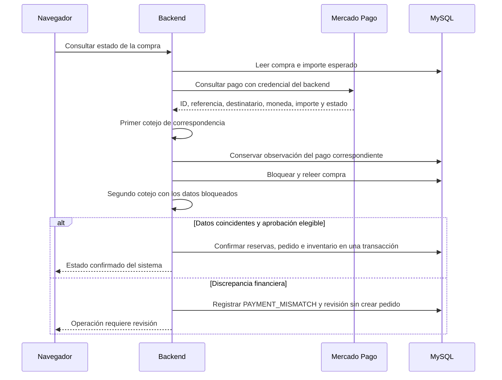

# Safety: prevención de confirmaciones financieras incorrectas

## Objetivo y alcance

Evitar que el Marketplace confirme una compra cuyo pago no corresponde a la operación esperada, tenga otro importe o moneda, o señale otra cuenta receptora. El destinatario esperado es la cuenta de Mercado Pago configurada para el Marketplace, no una cuenta bancaria ni cada vendedor.

La integración actual es de pruebas. Validar una aprobación del proveedor no demuestra una transferencia bancaria, disponibilidad para retiro ni liquidación neta después de comisiones. No se implementa reparto de dinero entre vendedores. No se realizan cobros reales para evaluar este atributo.

Se utiliza “Safety” en el alcance financiero solicitado: prevención de efectos perjudiciales por errores de operación, concurrencia o integración. La autenticación, firma de webhook y autorización contribuyen además a Security; no sustituyen las invariantes financieras.

## Relación con las diapositivas de Safety

Fuente de clase: **11. Safety.pdf**, 13 páginas, proporcionado por la estudiante. Las páginas citadas corresponden a su posición en el PDF. Se revisó el material completo; no se copia al repositorio.

### Qué estado inseguro se quiere evitar

La página 2 distingue Safety de Security y plantea evitar estados inseguros mediante evasión, detección, prevención y recuperación. En el alcance financiero del Marketplace, el estado inseguro es **confirmar una compra o consumir inventario sin un pago correspondiente, o generar efectos financieros/locales duplicados o incoherentes**. Esta es una adaptación del concepto a pérdidas económicas, no una afirmación de que el sistema es crítico para la vida o cuenta con certificación de seguridad funcional.

| Causa de la clase | Ejemplo concreto en pagos | Control y evidencia |
| --- | --- | --- |
| Omisión: un evento necesario no ocurre (p. 4) | No llega el webhook o falla la creación local después de observar el pago | Diario durable y mecanismos existentes de consulta/recuperación; no inferir rechazo por silencio. El barrido automático solo opera cuando está habilitado |
| Comisión: ocurre algo que no debe ocurrir (p. 4) | Crear un segundo pedido por una notificación repetida; confirmar un pago ajeno | Bloqueo, vínculo de transacción y validación de correspondencia; pruebas de duplicados y destinatario |
| Temporización temprana/tardía (p. 5) | Confirmar antes de verificar; recibir aprobación cuando la reserva ya venció | Cotejo antes de materializar y validación de vigencia de reservas; aprobación tardía pasa a revisión |
| Valores incorrectos, evidentes o sutiles (p. 5) | Moneda distinta, receptor incorrecto o diferencia de una unidad monetaria | Comparación exacta de receptor, moneda y total; prueba nueva con incremento de 1 durante la consulta. No equivale a detectar toda corrupción posible |
| Omisión/comisión en una secuencia (p. 6) | Descontar stock sin validar el pago o repetir el consumo | Secuencia de verificación seguida de transacción local; no se consumen reservas en la rama de discrepancia |
| Fuera de secuencia (p. 6) | Usar una lectura del total anterior a un cambio concurrente al confirmar | Segunda lectura con bloqueo y cotejo inmediatamente antes del efecto local |

### Tácticas seleccionadas y sus límites

| Táctica de la diapositiva | Aplicación real en este alcance | Estado |
| --- | --- | --- |
| Timeout (p. 11) | Cliente externo configurado con presupuesto de espera de 8 segundos; un fallo de consulta no se convierte en aprobación | Existente; no es una garantía de duración de toda la operación con múltiples llamadas |
| Timestamp (p. 11) | Vigencia de reservas, fechas de observaciones y vencimiento de turnos de recuperación | Existente; no afirmar que la marca temporal de la firma webhook por sí sola implementa una ventana antirrepetición |
| Monitoreo de condiciones / chequeo de sanidad (p. 11) | Referencia, ID, receptor, moneda, importe representable y vigencia de inventario | Existente, reforzado con cotejo del total bajo bloqueo |
| Comparación de salidas redundantes (p. 11) | No se usan dos proveedores o verificadores independientes | No implementada: ejecutar dos veces el mismo validador sobre la misma respuesta no constituye redundancia independiente |
| Limitar consecuencias / abortar (p. 12) | Impedir creación de pedido y consumo de inventario ante discrepancia | Aplicado al efecto local; no deshace ni cancela por sí mismo un cobro externo |
| Barrera / interlock (p. 12) | La confirmación local queda condicionada al cotejo financiero y las reservas válidas dentro de la secuencia controlada | Es la táctica principal del refuerzo: una barrera lógica bajo bloqueo de compra |
| Degradación y modo seguro (pp. 8, 12) | La compra afectada queda pendiente o en revisión según la causa; se conserva la evidencia y no se confirma automáticamente | Estado seguro local de esa operación; no implica apagar todo el Marketplace ni probar disponibilidad global |
| Modo manual (p. 8) | Una incidencia `REVIEW` requiere diagnóstico y resolución autorizada | No se añadió una pantalla ni un botón de aprobación manual. No corregir el estado con SQL para forzar aprobación |
| Separación de Safety (p. 13) | Validación y materialización viven en backend; diario separado de la transacción del pedido, interfaz sin autoridad para aprobar | Separación lógica existente; no hay proceso/hardware independiente ni aislamiento formal de un núcleo Safety |
| Monitor-actuador (p. 13) | Analogía: el cotejo monitorea las precondiciones antes de que la materialización cambie pedido/inventario | Analogía de diseño; no existe un actuador físico ni un monitor independiente |

Las tácticas de sustitución por hardware, modelos predictivos (p. 10), votación y redundancia triple modular (pp. 12–13) no se implementan: no son necesarias para este control acotado y no se atribuyen a Docker o a dos llamadas iguales. Los contenedores de despliegue no prueban por sí solos una barrera Safety.

### Recuperación: conservar el problema hasta resolverlo

Las páginas 7–8 contemplan modo seguro, apagado o modo manual como alternativas; no exigen aplicar todas a todo sistema. Aquí se elige contener la compra afectada y conservar la observación. Los fallos recuperables utilizan los mecanismos existentes de reconsulta y recuperación; una discrepancia financiera no se normaliza automáticamente como aprobación.

El planificador existente está condicionado a `payments.recovery.enabled=true`; definir la clase no demuestra que esté activo en un despliegue concreto. Tiene turnos de ejecución con vencimiento e intentos limitados. Una intervención posterior debe volver a consultar al proveedor y seguir el flujo financiero autorizado; “revisión” no acredita que ya exista un procedimiento operativo completo de atención manual.

### Frase para sustentación

> “Aplicamos Safety evitando el estado inseguro de confirmar una compra con datos financieros que no corresponden. Detectamos inconsistencias, usamos una barrera o interlock antes de crear el pedido y contenemos el fallo conservando la compra en revisión. El refuerzo repite el cotejo sobre la compra bloqueada; no son dos cobros ni dos fuentes independientes. La recuperación conserva evidencia y no inventa una aprobación.”

## Escenario arquitectónico

Identificador local `SAF-PAGO-01`; no se presenta como un nuevo identificador oficial del SAD.

| Elemento | Definición |
| --- | --- |
| Fuente | Proveedor de pagos, retorno del navegador, webhook o recuperación de pagos |
| Estímulo | Se observa un pago aprobado o repetido; los datos pueden no coincidir con la compra |
| Entorno | Compra en curso, incluso con cambios concurrentes o reintentos |
| Artefactos | Backend, compra persistida, registro de observaciones, pedido y reservas; Mercado Pago como sistema externo |
| Respuesta | Consultar al proveedor, cotejar identidad e importes, repetir el cotejo bajo bloqueo antes de materializar y confirmar solo si coinciden las condiciones |
| Medida comprobable | Cero pedidos creados y cero unidades descontadas en los casos de importe, moneda o destinatario incorrectos y cambio concurrente del total; una sola compra ante repeticiones |

Estas son condiciones de aceptación del cambio, no una certificación de todas las propiedades financieras del sistema.

## Riesgos y respuesta segura

| Peligro | Prevención/detección | Respuesta y límite |
| --- | --- | --- |
| Confirmar por un retorno de navegador manipulado | Consultar el pago al proveedor y cotejar ID/referencia | No confirmar a partir de parámetros del navegador |
| Atribuir dinero recibido por otra cuenta al Marketplace | Comparar receptor con `collector_id` configurado | Rechazar correspondencia; no registrarlo como pago propio |
| Confirmar una compra por importe o moneda diferentes | Comparación decimal y moneda COP | Registrar discrepancia de pago propio, mantener revisión |
| Cambiar el total entre lectura y confirmación | Segundo cotejo con compra bloqueada | Bloquear creación del pedido y preservar stock/carrito |
| Duplicar pedido por notificación repetida | Bloqueo y vínculo de transacción existentes | Reutilizar pedido; verificar con regresión de duplicados |
| Perder evidencia si falla la creación local | Diario durable independiente existente | Conservar observación y recuperar; no afirmar que no hubo cobro |
| Confundir aprobación con liquidación bancaria definitiva | Delimitar el estado mostrado y mantener resolución financiera | Reembolsos, contracargos y liquidación tienen evidencia y procesos distintos |

No se asignan probabilidades ni niveles de riesgo numéricos sin mediciones. La configuración del receptor sigue siendo una responsabilidad operativa: el sistema compara contra lo configurado, no puede adivinar cuál cuenta quería utilizar el equipo.

## Mecanismo de doble comprobación



Un pago de otra cuenta receptora o referencia se rechaza antes de registrarlo como pago propio. No se incorpora al diario de la compra. Un pago que sí pertenece a la operación pero difiere en importe/moneda queda registrado como incidencia y no se materializa como pedido.

### Primera barrera: correspondencia con el proveedor

Ya existía en la integración:

- El estado se obtiene desde `GET /v1/payments/{id}` con la credencial del backend; el parámetro de retorno `approved` no autoriza un pedido.
- El ID consultado debe coincidir con el ID devuelto.
- La referencia externa debe coincidir con la compra y `collector_id` con el destinatario configurado.
- Moneda COP e importe bruto deben coincidir exactamente con el total calculado por el servidor; se usa comparación decimal, no números de coma flotante.
- Se mantiene la política existente de cuentas de prueba: si el proveedor informa `live_mode=true`, se verifica que la cuenta del token sea la cuenta de prueba esperada. No se habilitan pagos productivos.

Fuente del contrato externo: [consulta de pagos de Mercado Pago](https://www.mercadopago.com.co/developers/es/reference/online-payments/checkout-api-payments/get-payment/get). El importe bruto no equivale al neto liquidado: véanse los [campos de reportes del proveedor](https://www.mercadopago.com.co/developers/en/docs/checkout-api-payments/resources/reports/activities-reports/report-fields).

### Segunda barrera: cotejo al confirmar

**Refuerzo de esta entrega:** después de bloquear y releer la compra con `FOR UPDATE`, el backend repite la validación de correspondencia contra ese total vigente. Cierra el intervalo entre la primera lectura, la consulta externa y la confirmación local. Una modificación del total durante la consulta no puede producir un pedido confirmado por otro importe.

La segunda comprobación reutiliza la respuesta ya consultada: no genera otro cobro ni exige dos llamadas idénticas al proveedor. Un bloqueo local no congela el estado externo; reembolsos y contracargos posteriores siguen teniendo su propio proceso financiero.

Ante discrepancia sin pedido previo: `REVIEW`, observación `PAYMENT_MISMATCH`, sin confirmar reservas ni descontar inventario ni vaciar carrito. Si ya se había cerrado localmente la compra, se conserva el cierre. No se inicia un reembolso automático de una discrepancia basándose solo en este cambio. Los pedidos ya vinculados conservan su tratamiento existente de actualizaciones financieras.

### Persistencia, recuperación y duplicados

Se conservan los mecanismos existentes: observación durable separada de la creación del pedido, vinculación del ID externo, bloqueo de compra, recuperación, y tratamiento financiero de cancelaciones/reembolsos. Un fallo local no se interpreta como “no hubo pago”; un pago rechazado o pendiente no confirma pedido. La repetición no debe crear dos pedidos ni consumir inventario dos veces.

## Cómo demostrarlo sin mostrar código

### Bitácora visible en la aplicación

Desde el estado del pago, abrir **Ver verificaciones del pago**. La aplicación consulta una bitácora persistida por el backend, no deduce las verificaciones del estado `APPROVED` ni del retorno de Mercado Pago. Cada fila presenta fase, resultado, fecha, identificador de consulta, ID del pago, importe/moneda y receptor esperados frente a observados.

- `FIRST / MATCH`: cotejo del pago consultado con la primera lectura de la compra.
- `SECOND / MATCH`: cotejo con la compra bloqueada, registrado en la misma transacción local. No significa por sí solo que el pago esté aprobado o que la reserva sea válida: el estado del pedido se muestra por separado.
- `MISMATCH`: discrepancia detectada; puede existir únicamente la primera fase si la segunda no se ejecutó.
- `SECOND / ALREADY_LINKED`: el pedido ya existía; no se volvió a ejecutar la confirmación ni se inventa un segundo cotejo histórico.

Las fases de una ejecución comparten `verificationId`. Nuevas consultas externas producen otra ejecución; consultar/actualizar la bitácora es lectura y no consulta al proveedor ni crea pagos. Se muestran hasta 100 filas recientes en orden cronológico.

La primera fase se guarda con transacción independiente después de conservar la observación del pago propio. Si falla la transacción que crea el pedido, el primer registro sobrevive y el segundo se revierte: no se deja una evidencia falsa de una segunda fase confirmada localmente. Si falla la escritura de evidencia, la operación no continúa como si se hubiera registrado correctamente.

**Históricos:** la migración V50 crea `payment_safety_checks` vacía; no rellena pagos anteriores. El pedido 28 conserva sus datos. Una consulta nueva sobre un pedido ya existente registra la comprobación actual y que no se repitió su confirmación; para observar las dos fases coincidentes previas a crear un pedido se necesita una compra nueva de sandbox después de actualizar el backend.

Solo el comprador propietario, con rol comprador activo, puede consultar `GET /api/payments/mercadopago/checkouts/{id}/safety-checks`. Otro comprador recibe 404; no se exponen tokens, contraseñas ni JSON completo del proveedor. No es una bitácora criptográficamente inmutable ni prueba de liquidación bancaria. La FK con borrado en cascada conserva el ciclo de vida de la compra; no se establece una nueva política legal de retención.

Para consultar directamente la evidencia sin abrir código:

```sql
SELECT verification_id AS consulta, payment_id AS pago, phase AS fase,
       result AS resultado, expected_amount AS importe_esperado,
       observed_amount AS importe_observado,
       expected_currency AS moneda_esperada, observed_currency AS moneda_observada,
       expected_collector AS receptor_esperado, observed_collector AS receptor_observado,
       provider_status AS estado_proveedor, recorded_at AS fecha
FROM payment_safety_checks
WHERE checkout_id = 'REEMPLAZAR_POR_ID_DE_COMPRA'
ORDER BY id;
```

1. En sandbox, realizar una compra y consultar su estado desde la aplicación. Mantener el túnel y configuración de la sesión válidos.
2. Mostrar que la operación corresponde al importe y referencia esperados y al destinatario configurado, sin revelar el token ni secretos.
3. Relacionar pago, compra y pedido con la consulta de abajo. El nombre de producto procede del pedido; antes de la confirmación puede no existir pedido.
4. Volver a consultar el mismo pago: comprobar que sigue vinculado al mismo pedido, sin otro descuento de inventario.
5. Para fallos de importe, moneda, destinatario y cambio concurrente, utilizar las pruebas automatizadas controladas. No alterar importes de la base real ni fabricar evidencias como si Mercado Pago hubiera enviado esos datos.

```sql
SELECT c.id AS compra,
       c.status AS estado_compra,
       c.total AS importe_esperado,
       p.payment_id AS pago,
       p.verified_status AS estado_reportado,
       p.amount AS importe_observado,
       p.currency AS moneda_observada,
       p.collector_id AS receptor_observado,
       p.resolution_status AS resultado_cotejo,
       p.verification_count AS consultas_registradas,
       p.order_id AS pedido_vinculado,
       o.transaction_id AS referencia_pedido,
       o.total AS total_pedido,
       i.product_name AS producto,
       i.quantity AS cantidad
FROM payment_checkouts c
LEFT JOIN external_payment_observations p ON p.checkout_id = c.id
LEFT JOIN orders o ON o.id = p.order_id
LEFT JOIN order_items i ON i.order_id = o.id
ORDER BY c.created_at DESC, c.id, p.payment_id, i.product_name
LIMIT 20;
```

La consulta muestra hasta 20 filas, no necesariamente 20 compras: una compra puede contener varios productos o intentos. Comparar el receptor observado con la configuración esperada por un canal autorizado. El contador registra observaciones persistidas, no dos aprobaciones humanas ni el número de barreras ejecutadas.

## Pruebas y evidencia

Las pruebas usan respuestas del proveedor controladas y MySQL temporal de Testcontainers; no transfieren dinero ni consultan una cuenta real.

```powershell
cd backend/demo
mvn.cmd -B "-Dtest=MercadoPagoClientTests,MercadoPagoCheckoutIntegrationTests,MercadoPagoH05SafetyTests,MercadoPagoH05FinancialTests,MercadoPagoCheckoutCancellationTests" test
```

| Evidencia | Comportamiento cubierto |
| --- | --- |
| `approvedPaymentWithWrongFinancialDataNeverConfirmsPurchase` (tres variantes nuevas) | Importe/moneda incorrectos quedan en revisión; destinatario ajeno se rechaza; cero pedidos y stock/carrito conservados |
| `secondCheckBlocksTotalChangedWhileProviderWasBeingConsulted` (nueva) | Primera lectura coincidente, total alterado durante consulta, segundo cotejo bloquea y conserva reservas |
| Suite de checkout existente | Aprobación, pendientes, rechazo, firma de webhook, snapshots, permisos y repetición |
| Suites H05 Safety y Financial y cancelación | Fallos locales/externos, resolución financiera y cancelaciones |

**Resultado local obtenido el 14 de noviembre de 2026:** Maven informa `BUILD SUCCESS`, con **91 pruebas, 0 fallos, 0 errores y 0 omitidas**. Se contrastó el resumen con los cinco XML de Surefire:

| Clase | Pruebas aprobadas |
| --- | ---: |
| MercadoPagoClientTests | 8 |
| MercadoPagoCheckoutIntegrationTests | 14 |
| MercadoPagoH05SafetyTests | 20 |
| MercadoPagoH05FinancialTests | 25 |
| MercadoPagoCheckoutCancellationTests | 24 |
| Total | 91 |

Ejecución con Java 21, MySQL 8.4.11 temporal y proveedor controlado, sin tocar la base local del Marketplace. Duración informada por Maven: 3 min 27 s. Evidencia local: `artifacts/safety/pruebas-financieras.log` (archivo generado, no versionado) y `backend/demo/target/surefire-reports/`. PowerShell registró además un `NativeCommandError` por salida del proceso; el resultado de las pruebas se acredita mediante el resumen Maven y los XML, no mediante el código de salida del envoltorio PowerShell.

El primer intento se detuvo antes de las pruebas por una versión de Java seleccionada por Maven incompatible con release 21; se corrigieron `JAVA_HOME` y `PATH` únicamente para el proceso de pruebas. No se cambiaron variables globales.

No se ejecutó la suite global ni una medición nueva de cobertura, ni una compra manual real/sandbox durante esta entrega. No se afirma porcentaje de cobertura o aprobación global a partir de esta selección de pruebas.

### Validación adicional de la bitácora y vista

El 14 de noviembre de 2026, después de añadir la bitácora:

- **108 pruebas backend aprobadas**, cero fallos, errores u omitidas, `BUILD SUCCESS` (4 min 6 s): las cinco clases anteriores y `MercadoPagoH05RecoveryTests` (15) y `MercadoPagoH05ConcurrentReadTests` (1). Checkout aumenta de 14 a 15 por la prueba de consulta, propiedad, lectura sin efectos e historial no inventado.
- La prueba de modificación concurrente comprueba fases `MATCH` y `MISMATCH` enlazadas por el mismo ID de verificación y los importes de ambas lecturas.
- La prueba de fallo de persistencia comprueba que solo queda `FIRST` después del rollback y que un reintento registra una nueva primera fase y la segunda confirmada localmente.
- **25 pruebas Chrome aprobadas** de `mercadopago.spec.ts` y `mis-pedidos-comprobante.spec.ts` (54,5 s), incluidas las dos nuevas de bitácora. Compilación Angular completada.
- Evidencia generada localmente: `artifacts/safety/bitacora-backend.log`, `bitacora-e2e.log`, `bitacora-build.log` y XML de Surefire. Proveedor controlado para backend e interfaz; las pruebas visuales no consultan una cuenta real de Mercado Pago.

No se repitió la suite global ni se midió cobertura en esta validación. Estos resultados sustituyen el estado pendiente de las funciones nuevas; no representan dinero real transferido ni pruebas humanas de usabilidad.

## Archivos y límite del cambio

- `MercadoPagoCheckoutService.java`: segunda validación dentro de la transacción bloqueada.
- `MercadoPagoCheckoutIntegrationTests.java`: cuatro ejecuciones adicionales de pruebas financieras.
- `V50__payment_safety_checks.sql`: registros nuevos, sin reconstruir un historial supuesto.
- `MercadoPagoPaymentJournal.java`: primera fase durable y segunda fase en la transacción local.
- `MercadoPagoController.java`: consulta de lectura protegida por comprador y propiedad.
- Componentes, modelo y servicio de checkout del frontend: vista de verificaciones, carga, errores y limpieza al cambiar de cuenta/rol.
- `MercadoPagoH05SafetyTests.java`: evidencia de que rollback conserva solo la primera fase.
- `frontend/e2e/mercadopago.spec.ts`: visualización de fases, discrepancias, ausencia de historial y fallo de consulta sin cambiar el estado del pago.
- Este documento: escenario, mecanismos existentes/refuerzo, evidencias y demostración.

No se cambia la cuenta receptora, los secretos, las reglas de catálogo, las comisiones, ni se activa producción. Se incorpora una vista de lectura de verificaciones dentro del estado del pago; no hay aprobación manual por dos personas. La doble comprobación es automática y verificable en backend.
