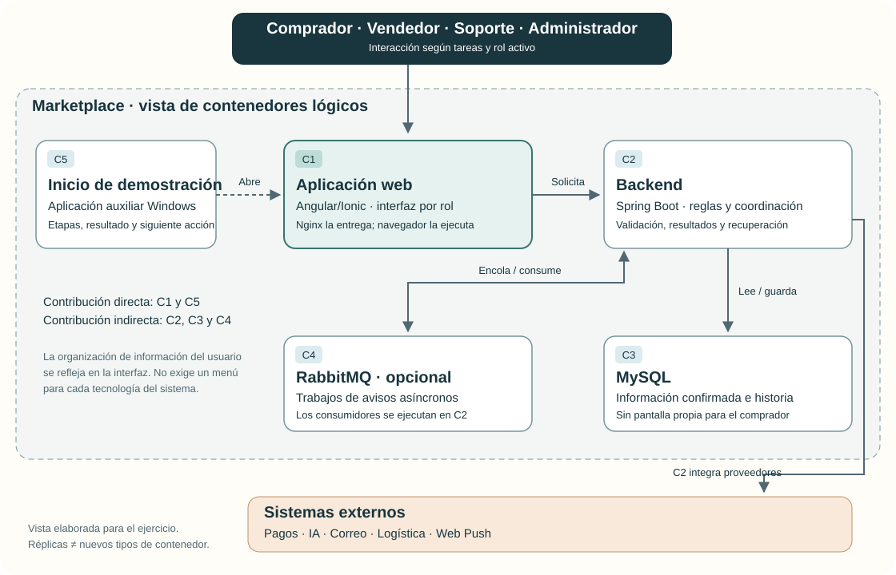

# Usabilidad: ejercicio de arquitectura de información por contenedor C4

Este ejercicio explica cómo organizar la información y las interacciones del Marketplace para que las personas puedan comprenderlo y realizar sus tareas. La sustentación se realiza con mapas, recorridos, wireframes y decisiones de diseño. No necesita mostrar código, consultas SQL, clases ni terminales.

**Estado:** análisis del sistema existente y propuesta de diseño. Los wireframes son propuestas; no representan una nueva interfaz desplegada. La inspección del repositorio no equivale a una investigación con usuarios. Las metas de la evaluación todavía no tienen resultados de participantes.

**Evaluación transversal:** consultar el [informe y protocolo del proyecto completo](../pruebas/usabilidad-proyecto-completo.md), con mapa actual, módulos de todos los roles, 25 tareas y formatos de evidencias. Este ejercicio C4 lo complementa y no restringe la evaluación a CU-01 a CU-06.

[Abrir la vista visual para la sustentación](../sustentacion/usabilidad-marketplace.html). Descargar o abrir el archivo HTML en el navegador; funciona sin iniciar Docker ni conectarse a servicios externos.

[Abrir la versión PDF](../sustentacion/usabilidad-marketplace.pdf), preparada para proyectar o compartir sin abrir el código de la presentación.

## 1. Cómo se aplicaron las diapositivas

Fuente principal: **14. Usability.pdf**, 44 páginas, proporcionada por la estudiante. Las referencias siguientes corresponden a la posición de la página en el PDF, no a una numeración del SAD. No se reproduce la presentación completa en el repositorio.

| Material de clase | Aplicación al Marketplace | Artefacto del ejercicio |
| --- | --- | --- |
| Páginas 2–20: recorridos bancarios, pasos y desplazamientos confusos | Identificar obstáculos concretos antes de cambiar colores o añadir controles | Diagnóstico y recorridos por tarea |
| Página 25: aprendizaje, eficiencia, recordación, errores y satisfacción | Evaluar las cinco dimensiones por separado | Protocolo y registro de evaluación |
| Páginas 26, 28–30: estrategia y objetivos de usuarios y producto | Distinguir comprador, vendedor, soporte, administración y operador de demostración | Matriz de objetivos y necesidades |
| Página 32: alcance, funcionalidad, contenido y responsables de actualizarlo | Definir qué información necesita cada tarea y de dónde proviene | Inventario de información |
| Páginas 34–35: estructura y arquitectura de información | Combinar organización jerárquica, matricial, contextual y secuencial según la tarea | Mapa de navegación y decisiones de organización |
| Páginas 36–37: modelos conceptuales e interacción | Explicar carrito, pedido, dirección guardada, alerta y bandeja con lenguaje del usuario | Recorridos y estados comprensibles |
| Páginas 39–41: esqueleto, wireframes, pantallas, enlaces y controles | Colocar contexto, formulario, acciones y recuperación en un orden explícito | Wireframes de direcciones y compra |
| Páginas 42–43: superficie y orden de lectura | Priorizar título, información importante, acción principal y ayuda; mantener contraste y consistencia | Criterios visuales y de presentación |

No se trata la estética como prueba suficiente de usabilidad. Una pantalla atractiva puede seguir siendo difícil de encontrar, comprender o utilizar.

## 2. Contenedores y límites del ejercicio

La vista se deriva de la aplicación y sus archivos de despliegue revisados. Los identificadores C1–C5 son referencias de este ejercicio, no nuevos códigos oficiales de requisitos. Una réplica Docker adicional no constituye otro tipo de contenedor C4.

| ID | Contenedor lógico | Relación con la persona |
| --- | --- | --- |
| C1 | Aplicación web Angular/Ionic; Nginx entrega la aplicación al navegador | Interacción directa con comprador, vendedor, soporte y administrador |
| C2 | Backend Spring Boot, incluida la coordinación de trabajos de notificación | Contribución indirecta: reglas, validación, resultados y recuperación de operaciones |
| C3 | Base de datos MySQL | Contribución indirecta: conservar información propia, preferencias y datos históricos consistentes |
| C4 | RabbitMQ, cuando se activa la configuración de notificaciones | Contribución indirecta: desacoplar el envío de avisos de la tarea principal; los consumidores pertenecen a C2 |
| C5 | Aplicación auxiliar de inicio de demostración para Windows | Interacción directa con la persona que prepara la demostración; no es una pantalla del comprador ni un servicio Docker |

Mercado Pago, el proveedor de IA, los proveedores de correo, logística y Web Push son **sistemas externos**, no contenedores internos adicionales. Su interacción afecta la experiencia y se considera en los recorridos. El service worker es parte del cliente web; no se cuenta como otro contenedor C4. Nginx y las réplicas del despliegue no añaden nuevas tareas de navegación para el comprador.

El frontend concentra la presentación. El backend, MySQL y RabbitMQ no necesitan un menú para el comprador: se diseña la información que conservan, coordinan o entregan a la interfaz. Las consolas técnicas de administración no forman parte de la navegación del Marketplace.

## 3. Estrategia: personas y resultados esperados

| Persona | Necesidad principal | Información necesaria | Resultado esperado |
| --- | --- | --- | --- |
| Comprador | Encontrar, guardar y comprar productos; gestionar entregas y posventa | Precio, disponibilidad, estado, dirección, total y consecuencias de cada acción | Completar su tarea sin interpretar términos internos |
| Vendedor | Administrar su catálogo y atender ventas | Productos propios, inventario, pedidos, reseñas y estado de su tienda | Identificar qué requiere atención y actuar sobre sus recursos |
| Soporte | Revisar reportes y reclamaciones | Caso, contenido reportado, antecedentes pertinentes, estado y motivo de decisión | Decidir con contexto y comunicar el resultado |
| Administrador | Administrar catálogo y evaluar tiendas | Tiendas elegibles, antecedentes confirmados, medidas y consecuencias | Aplicar decisiones justificadas y comprender por qué una lista está vacía |
| Operador de demostración | Iniciar el sistema y reconocer si está disponible | Etapa actual, espera, resultado y siguiente acción | Preparar la demostración sin adivinar qué ocurrió |

Objetivo del producto: reducir errores y abandonos por información mal organizada, conservando los permisos y las reglas de negocio. La reducción real de errores o abandonos requiere medir una línea base y una evaluación posterior; no se da por obtenida en este documento.

## 4. Alcance: inventario y responsabilidad de la información

| Conjunto de información | Quién la actualiza / cuándo | Recorrido y organización | Contenedores responsables |
| --- | --- | --- | --- |
| Catálogo: nombre, precio, categoría, disponibilidad y visibilidad | Vendedor, moderación y administración cuando cambia la publicación o tienda | Categoría → producto; filtros combinables; enlaces contextuales | C2 aplica reglas, C3 conserva datos, C1 presenta |
| Recomendaciones y alternativas | Backend al consultar, con IA cuando está disponible | Recomendación → ficha → comparar o guardar | C2 selecciona candidatos visibles; C1 ofrece la entrada al contenido |
| Favoritos y alertas | Comprador al guardar o configurar; sistema al evaluar cambios | Lista personal → producto → condición de alerta | C1, C2, C3; C4 para envío externo cuando está habilitado |
| Direcciones | Comprador al registrar, editar, elegir o retirar | Cuenta → direcciones; acceso contextual desde la compra | C1, C2 y C3 |
| Carrito y resumen de compra | Comprador al cambiar cantidades, envío, dirección o cupón; servidor al recalcular | Carrito → entrega → revisión → pago → resultado | C1, C2 y C3, con pasarela externa |
| Pedido y dirección utilizada en esa compra | Sistema al confirmar y avanzar el pedido | Mis pedidos → detalle → acción disponible según estado | C2 y C3 conservan historia; C1 explica estado y acciones |
| Reseña y valoración consolidada | Comprador elegible; vendedor al responder; sistema al recalcular | Pedido entregado → producto → reseña → publicación | C1, C2 y C3 |
| Notificación interna y aviso externo | Sistema al registrar el evento y procesar el envío | Bandeja → notificación → recurso relacionado | C3 conserva, C2 coordina, C4 desacopla el envío, C1 muestra |
| Reportes y tiendas evaluables | Personas autorizadas al reportar o decidir | Bandeja de casos → evaluación → decisión → confirmación | C1, C2 y C3 |

Los filtros del catálogo constituyen una organización **matricial** porque combinan dimensiones como categoría y precio. Las fases de compra constituyen un avance **secuencial**; dentro de la entrega hay una matriz de alternativas de dirección y envío. La diapositiva 35 presenta checkout como ejemplo matricial: ambas perspectivas son compatibles cuando se distingue la elección de opciones del avance por etapas. Los enlaces producto–reseña–recomendación forman una navegación contextual o no lineal.

## 5. Diagnóstico observado y decisiones de arquitectura de información

La columna «observado» procede de inspección estática de la interfaz y de los problemas comunicados durante las pruebas manuales. No representa una sesión formal de investigación con participantes.

| Observado | Problema de información | Decisión propuesta | Estado |
| --- | --- | --- | --- |
| El menú «Mis compras» agrupa favoritos y direcciones bajo «Después de comprar» | Mezcla tareas previas, durante y posteriores a la compra | Agrupar por intención y momento de la tarea | Propuesta de navegación |
| Aparecen «Crear cuenta de comprador / Habilitar COMPRADOR» y «Mi perfil y preferencias» como accesos separados en la página | Mezcla registro, habilitación de rol y cuenta personal; utiliza vocabulario interno | Acceso «Mi cuenta»; presentar «Crear cuenta» a visitantes y «Activar compras» solo cuando corresponda | Propuesta; conservar autorización y habilitación existentes |
| El formulario de direcciones se movió debajo de los botones y antes de las tarjetas guardadas | Se corrigió la búsqueda del formulario al final de una lista larga | Conservar acciones y formulario en el mismo bloque de atención | Presente en la interfaz inspeccionada; falta evaluación con usuarios |
| «Evaluar tiendas» presenta solo tiendas con antecedentes confirmados | Una lista vacía puede interpretarse como ausencia total de tiendas | «No hay tiendas con antecedentes confirmados para evaluar» y explicación del criterio | El texto explicativo existe; debe verificarse su comprensión |
| El catálogo y las recomendaciones aplican reglas de visibilidad | Una entrada que luego no puede consultarse produce frustración | Mantener las recomendaciones alineadas con productos que pueden mostrarse | Comportamiento técnico existente; no mide satisfacción |
| Se distinguen aviso interno, permiso del navegador y envío push | «Activado» puede confundirse con «entregado» | Explicar que el permiso está habilitado sin afirmar entrega; permitir volver a la bandeja interna | Decisión de contenido; evaluación pendiente |

## 6. Estructura: mapa propuesto de navegación por rol

La cabecera mantiene búsqueda, carrito, pedidos, notificaciones y cuenta como accesos reconocibles. El menú complementario tiene un nombre acorde con el rol. Los cambios de agrupación siguientes son una **propuesta de diseño**, no un cambio ya aplicado a todos los menús.

| Rol | Grupo | Destinos |
| --- | --- | --- |
| Visitante | Explorar | Catálogo, búsqueda, ficha y recomendaciones disponibles |
| Visitante | Acceder | Iniciar sesión, crear cuenta, recuperar acceso |
| Comprador | Explorar y guardar | Mis favoritos y alertas; acceso al catálogo |
| Comprador | Compras y entregas | Mis pedidos, Mis direcciones; carrito en cabecera |
| Comprador | Después de comprar | Mis reseñas, Mis devoluciones, Mis reclamaciones |
| Comprador | Ayuda y seguimiento | Conversaciones, Mis reportes; notificaciones en cabecera |
| Vendedor | Catálogo | Mis productos, Inventario |
| Vendedor | Ventas y atención | Pedidos recibidos, Reseñas recibidas, Devoluciones recibidas, Reclamaciones |
| Vendedor | Tienda y seguimiento | Mi tienda, Estado de mi tienda, Analítica, Conversaciones, Mis reportes |
| Soporte | Atención de casos | Moderación de reportes, Reclamaciones escaladas |
| Administrador | Plataforma | Evaluar tiendas, Configurar catálogo |
| Persona autenticada | Mi cuenta | Perfil y preferencias, rol activo cuando corresponda, cierre de sesión |

La navegación por rol reduce opciones irrelevantes; los permisos siguen siendo responsabilidad del backend. Ocultar un botón no concede ni revoca acceso.

### Recorridos críticos y puntos de recuperación

| Recorrido | Ruta de información | Recuperación diseñada |
| --- | --- | --- |
| CU-01/02: explorar y decidir | Catálogo o recomendación → ficha → guardar, comparar o agregar | Sin resultados: explicar el criterio y ofrecer limpiar filtros o explorar catálogo |
| CU-03: comprar | Carrito → dirección/envío → resumen actualizado → pasarela → estado confirmado por el sistema | Un pago pendiente no se presenta como aprobado ni se invita a repetirlo; ofrecer consultar estado |
| CU-04: seguir producto | Favoritos → configurar precio o variante agotada → alerta → aviso → producto | Condición ya cumplida: informar; fallo externo: conservar aviso interno; pausa: explicar que deja de avisar |
| CU-05: reseñar | Pedido entregado → producto comprado → calificación → comentario/imagen opcionales → publicar | Señalar imagen o dato inválido y conservar los demás campos; explicar una compra no elegible |
| CU-06: gestionar entrega | Mi cuenta/menú → Mis direcciones → nueva o editar → guardar → confirmación | Error junto al campo; conservar datos; confirmar eliminación y explicar restricciones |
| Suspensión/moderación | Bandeja elegible → caso o tienda → antecedentes → decisión → motivo → confirmación | Lista vacía informativa, cancelación antes de confirmar y consecuencias explícitas |

## 7. Los cinco planos aplicados a cada contenedor

### C1. Aplicación web

| Plano | Decisión y evidencia que se presenta |
| --- | --- |
| Estrategia | Permitir que cada rol encuentre su tarea sin conocer la estructura técnica. Mostrar necesidades y recorrido del comprador. |
| Alcance | Separar explorar, comprar, entrega, posventa y cuenta. Mostrar inventario de contenido y responsables. |
| Estructura | Navegación por intención, jerarquía catálogo–producto, filtros combinables y avance de compra por fases. Mostrar mapa por rol. |
| Esqueleto | Contexto → datos → validación → acción principal → confirmación. Mostrar wireframes y enlaces; formulario de dirección encima de la lista. |
| Superficie | Títulos claros, importes en moneda local, estados con texto e icono, foco visible y contraste suficiente; no depender solo del color. Mostrar jerarquía de lectura. |

Modelo conceptual: «guardo una dirección y la elijo en mi compra»; no «creo un registro cada vez que calculo el total». La metáfora del carrito permite revisar antes de confirmar. La bandeja permite encontrar avisos aunque no aparezca una notificación del sistema operativo.

### C2. Backend

| Plano | Contribución indirecta a la experiencia |
| --- | --- |
| Estrategia | Que la tarea tenga un resultado comprensible y corresponda a la persona autorizada. |
| Alcance | Validar, resolver disponibilidad y permisos, calcular resultados y distinguir operación pendiente, aprobada, rechazada o recuperable. |
| Estructura | Modelo de estados de la tarea, con acciones permitidas y motivos de restricción. El usuario recibe conceptos del negocio. |
| Esqueleto | Entregar al frontend información de qué ocurrió, qué dato corregir, qué se conservó y cuál es el siguiente paso. |
| Superficie | C1 redacta y presenta el mensaje; C2 no impone terminología de excepción, tablas o infraestructura. La normalización completa de mensajes requiere revisión funcional posterior. |

Ejemplo de contenido propuesto: «No puedes eliminar esta dirección porque hay un pedido en proceso. Puedes usar otra dirección para una compra nueva». La API y la interfaz deben coincidir sobre la restricción; el diseño no autoriza ignorarla.

### C3. MySQL

| Plano | Contribución indirecta a la experiencia |
| --- | --- |
| Estrategia | Que la información propia permanezca y resulte coherente al volver a la aplicación. |
| Alcance | Direcciones guardadas, predeterminada única, pedidos, copia histórica de entrega, alertas, reseñas y notificaciones. |
| Estructura | Diferenciar información actual de la cuenta e información histórica de una compra; no mezclar recursos de dos personas. |
| Esqueleto | Respalda los grupos «Direcciones guardadas» y «Dirección utilizada en esta compra», y la restauración de información confirmada. |
| Superficie | C1 formatea precios, fechas y valores no aplicables. No mostrar «NULL» como explicación para una persona. |

Evidencia de arquitectura: un esquema conceptual que relaciona persona → direcciones y persona → pedido → dirección histórica. No hace falta mostrar tablas ni SQL. Persistencia no significa que todo borrador del formulario sobreviva al cierre: esa capacidad debe diseñarse y verificarse por separado.

### C4. RabbitMQ y flujo de avisos

| Plano | Contribución indirecta a la experiencia |
| --- | --- |
| Estrategia | Que esperar el aviso externo no impida seguir usando el Marketplace. |
| Alcance | Transportar trabajos de aviso y permitir recuperación de fallos mediante consumidores del backend; el aviso interno se conserva en MySQL. |
| Estructura | Distinguir evento registrado, trabajo de envío, resultado del proveedor y lectura de la persona. Son conceptos diferentes. |
| Esqueleto | Diseñar qué verá la persona si el envío demora o falla: volver a la bandeja y al recurso; no pedir que cree otra alerta para reintentar un aviso. |
| Superficie | Mensajes propuestos: «Tu aviso está disponible en Notificaciones» y «Los avisos del navegador requieren permiso». No exponer nombres de colas, intentos o errores del broker al comprador. |

Un trabajo aceptado por la cola o el proveedor no prueba que la persona vio la notificación. La consola de RabbitMQ es evidencia técnica de procesamiento, no evidencia de facilidad de uso. Esta contribución aplica cuando la cola está habilitada; la persistencia de la bandeja no depende de una ventana push visible.

### C5. Aplicación de inicio de demostración

| Plano | Decisión para la persona que prepara el entorno |
| --- | --- |
| Estrategia | Preparar la demostración y saber cuándo puede comenzar. |
| Alcance | Comprobar prerrequisitos, informar etapas, abrir el navegador y orientar ante un error de preparación. |
| Estructura | Secuencia comprobar → preparar → iniciar → listo; salida de error con siguiente acción. |
| Esqueleto | Mostrar etapa actual, aviso de espera y acción «Abrir Marketplace» o instrucción de recuperación. El launcher actual informa por consola; la tarjeta visual es un storyboard propuesto, no una GUI existente. |
| Superficie | Lenguaje operativo breve y resultado persistente; detalles técnicos secundarios para diagnóstico. La evaluación corresponde al operador, no al comprador. |

## 8. Esqueleto y superficie: wireframes para la sustentación

La [vista visual](../sustentacion/usabilidad-marketplace.html) muestra dos wireframes sin conexión al sistema:

1. **Direcciones:** título y contexto, botones, formulario inmediatamente debajo, errores junto al campo, guardar/cancelar y tarjetas guardadas. Un selector de opción única elige una dirección; no casillas de selección múltiple.
2. **Compra:** fases de entrega, revisión y pago; dirección elegida y total visibles; vuelta a editar sin perder el contexto. El botón de pago describe que se continuará en una pasarela externa.

Las confirmaciones y estados de la demostración visual son simulaciones de diseño. No guardan datos, no crean pedidos y no envían avisos. Se utilizan datos ficticios.

Orden de lectura propuesto: dónde estoy → qué debo hacer → qué información necesito → acción principal → resultado o recuperación. Texto más grande, agrupación y espacio comunican prioridad; el naranja identifica la acción principal, y el texto explica siempre el estado. Conservar una tipografía legible, navegación con teclado y etiquetas asociadas a controles; verificar contraste en la interfaz definitiva.

## 9. Escenario de calidad y evaluación

Escenario **U-01 de este ejercicio**, sin reemplazar la numeración oficial del SAD:

| Elemento | Definición |
| --- | --- |
| Fuente | Comprador autenticado que usa la gestión de direcciones por primera vez |
| Estímulo | Necesita corregir su dirección antes de pagar e ingresa inicialmente un teléfono inválido |
| Entorno | Navegador de escritorio o ancho móvil; una dirección guardada; un error recuperable de guardado en un segundo intento |
| Artefactos | C1 presenta; C2 valida y explica; C3 conserva la dirección confirmada; el recorrido de compra conserva su contexto |
| Respuesta | Encuentra la sección, comprende el error, corrige sin reescribir campos válidos y reconoce cuándo se guardó; no se elimina la información confirmada por un fallo |
| Medida existente | RNF-027: mensaje específico junto a cada campo inválido y conservación de datos válidos cuando sea posible |
| Metas propuestas | Al menos 90 % de tareas completadas sin ayuda; acceso a «Nueva dirección» en hasta tres activaciones desde el inicio; cero errores críticos. Tiempos y satisfacción se miden por separado. No son resultados obtenidos ni requisitos aprobados adicionales. |

### Protocolo que falta ejecutar con personas

Evaluación exploratoria propuesta: cinco compradores, preferiblemente con diferente familiaridad con el sistema, y al menos una persona representativa de cada rol administrativo/operador para sus recorridos. No es una muestra para certificar toda la población. Usar cuentas y datos ficticios, consentimiento y registro sin contraseñas ni información personal innecesaria.

| Dimensión de la página 25 | Tarea y medición | Meta propuesta, por acordar | Estado |
| --- | --- | --- | --- |
| Aprendizaje | Primer intento de encontrar y guardar una dirección: éxito, ayudas y tiempo | Completar sin ayuda; registrar duración antes de fijar un límite definitivo | No medido |
| Eficiencia | Repetir selección de dirección y revisión de compra: activaciones y tiempo de tarea | Hasta tres activaciones para abrir «Nueva dirección»; comparar antes/después con el mismo punto de inicio | No medido |
| Recordación | Repetir la tarea 24–48 horas después sin guía | Al menos cuatro de cinco participantes la completan sin ayuda; resultado descriptivo | No medido |
| Errores y recuperación | Teléfono inválido, guardar con fallo recuperable y eliminación bloqueada | Identificar el problema sin perder campos; cero borrados o pagos involuntarios | No medido con participantes |
| Satisfacción | Pregunta posterior a cada tarea, escala 1–5, y comentario libre | Mediana de al menos 4; registrar también críticas y abandonos | No medido |

Registrar inicio/fin con el mismo criterio; separar tiempo de tarea de latencia del servidor. Una activación es pulsar un botón o enlace; escribir un texto se registra aparte. No comparar tiempos de tareas diferentes como si fueran una mejora de la misma tarea. No se fijó un número ficticio de pasos para toda la aplicación.

Registro listo para diligenciar:

| Participante anónimo / rol | Tarea / versión / dispositivo | Éxito sin ayuda | Activaciones / tiempo | Error / recuperación / ayuda | Valoración 1–5 / observación |
| --- | --- | --- | --- | --- | --- |
| Pendiente | Pendiente | Sin medir | Sin medir | Sin medir | Sin medir |

Las pruebas automatizadas existentes pueden respaldar conservación de datos, permisos o restricciones. No sustituyen estas observaciones, ni prueban recordación, satisfacción o que alguien encontró intuitivamente un control.

## 10. Guion breve de sustentación

1. **Necesidad:** «Organizamos la información según lo que necesita hacer cada persona, no según paquetes o tablas».
2. **Mapa C4:** señalar C1–C5 y explicar cuáles interactúan directamente y cuáles sostienen la experiencia.
3. **Cinco planos:** presentar estrategia y contenido, luego navegación, wireframes y jerarquía visual; recorrer una ficha por contenedor.
4. **Ejemplo:** abrir direcciones desde el mapa y mostrar dónde aparece el formulario, qué pasa con un teléfono inválido y cómo se reconoce el resultado.
5. **Colaboración:** relacionar C1 con validación C2 y persistencia C3; explicar que C4 permite procesar avisos sin detener la tarea.
6. **Límite de evidencia:** «El ejercicio y los wireframes están preparados. La validación con participantes está pendiente y no la reemplazamos con cobertura de código».

## 11. Evidencia de la inspección

La presentación principal no muestra código. Estas referencias permiten auditar el diagnóstico después de la exposición:

| Referencia del repositorio | Qué se inspeccionó |
| --- | --- |
| `compose.yaml` y `compose.notificaciones.yaml` | Frontend, backend, MySQL y configuración opcional de RabbitMQ |
| `launcher/Marketplace/Program.cs` y guía de inicio Windows | Aplicación auxiliar, etapas y mensajes de preparación |
| `frontend/src/app/app.component.ts` y `app.component.html` | Agrupación por rol, cabecera y accesos de cuenta |
| `frontend/src/app/direcciones/` | Formulario antes de tarjetas, selección única y mensajes por campo |
| `backend/demo/src/main/java/com/transformersas/marketplace/address/` | Propiedad, predeterminada y restricciones de eliminación |
| Módulos de recomendaciones, suspensiones y notificaciones | Visibilidad del contenido, criterio de tiendas evaluables y separación aviso interno/envío |
| `docs/casos-de-uso/cu-04-favoritos-y-alertas.md`, CU-05 y CU-06 | Contratos de los recorridos seleccionados |

El documento de ASR disponible en el repositorio no aporta una numeración oficial de un nuevo escenario de usabilidad. Por eso este anexo no inventa un ASR adicional ni modifica el SAD. No se cambiaron las reglas de negocio, los datos locales o los permisos para elaborar el ejercicio.
