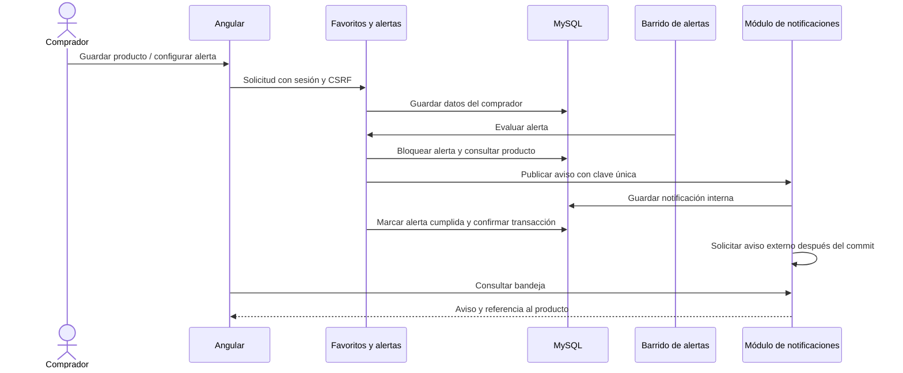

# CU-04: favoritos y seguimiento de productos

## Comportamiento

El comprador autenticado puede guardar o retirar un producto usando el corazón del
catálogo. El corazón naranja indica un favorito. La información se guarda en MySQL
por cuenta y se recupera después de recargar o iniciar sesión de nuevo; no se usa
`localStorage` ni `sessionStorage`.

Desde la bolita naranja inferior izquierda se abre **Mis favoritos y alertas**.
La lista permite actualizar los datos, ordenar los productos cargados por nombre,
precio o fecha de guardado, cargar páginas adicionales, ver el detalle, agregar al
carrito, comparar y copiar un enlace al producto. El backend aplica las reglas
vigentes del carrito. Comparar conserva el máximo de tres productos y la validación
de categoría del catálogo existente.

El precio y las existencias se consultan del producto actual, no de una copia del
momento en que se guardó. Las publicaciones pausadas permanecen visibles con su
estado. Las publicaciones retiradas, borradores y contenido oculto por moderación
se presentan como no disponibles, sin exponer sus datos actuales.

## Alertas

- **Precio:** objetivo positivo, hasta dos decimales. Si el precio actual ya es
  igual o menor, se informa de inmediato y no se crea una alerta activa.
- **Disponibilidad:** se selecciona una variante existente y agotada. El aumento
  de stock de otra variante o del producto general no cumple esta condición.
- Se pueden consultar, modificar, pausar, reactivar y eliminar las alertas propias.
  La modificación de disponibilidad permite seleccionar otra variante agotada.
- Cada alerta activa se cumple una vez. Después queda `TRIGGERED` y se puede
  reactivar cuando la condición deje de cumplirse. La reactivación incrementa su
  revisión, por lo que un nuevo cumplimiento es un evento diferente.
- No se permiten dos alertas activas o pausadas del mismo comprador para el mismo
  producto, tipo y variante. Límites por cuenta: 500 favoritos y 500 alertas no
  eliminadas. Estos límites acotan consultas y almacenamiento.

| Estado persistido | Significado |
| --- | --- |
| `ACTIVE` | La condición se evalúa. |
| `PAUSED` | Se conserva, sin generar avisos. |
| `TRIGGERED` | Se cumplió; no vuelve a avisar sin reactivación o modificación. |
| `DELETED` | Se excluye de la lista y de la evaluación. |

Si al modificar una alerta de precio su condición ya se cumple, queda sin actividad
y se informa inmediatamente. Una publicación inactiva o una variante que ya no
existe no genera avisos. El nombre de la variante se guarda porque el modelo actual
no tiene un identificador independiente; si se renombra, se debe editar la alerta.
Reordenar variantes conserva el seguimiento por nombre.

## Evaluación y notificaciones

Un barrido configurable procesa lotes de hasta 100 alertas activas. Usa un cursor
para recorrerlas sin quedarse siempre en el primer lote. Cada evaluación tiene su
propia transacción, por lo que el error de una alerta no impide evaluar las demás.

Dentro de esa transacción se bloquea la alerta, se verifica el producto actual y,
si se cumple, se crea una notificación interna y se cambia el estado a `TRIGGERED`.
La clave `product-alert-{UUID}-{revision}` y la restricción única de notificaciones
evitan duplicados. Si hay rollback, no se confirma ninguno de esos cambios.

El módulo existente despacha la notificación externa **después del commit**, fuera
del hilo de la solicitud y mediante un ejecutor acotado. Un error del proveedor
conserva la notificación interna y registra el resultado externo para diagnóstico
y recuperación. No se incluye un nuevo proveedor ni un reintento automático.

La bandeja se abre desde el icono de mensajes del encabezado. Mientras está abierta,
consulta novedades cada dos segundos y ofrece **Ver producto** para una alerta.
El envío externo puede usar el simulador existente o el adaptador HTTP configurado;
no significa que se esté enviando un correo real por defecto.



## Contratos y almacenamiento

Todos los endpoints siguientes requieren el rol activo `COMPRADOR`. La cuenta se
obtiene de la sesión; no se acepta un `user_id` elegido por el navegador. Las
escrituras requieren CSRF. Operar sobre una alerta ajena devuelve 404.

| Método y ruta | Función |
| --- | --- |
| `GET /api/favorites?page=0` | Página de hasta 50 favoritos con datos actuales. |
| `GET /api/favorites/ids` | Identificadores para los corazones del catálogo. |
| `PUT /api/favorites/{productId}` | Guardar, de forma idempotente. |
| `DELETE /api/favorites/{productId}` | Retirar el favorito de la cuenta. |
| `GET /api/favorites/alerts` | Consultar las alertas propias no eliminadas. |
| `POST /api/favorites/alerts` | Crear una condición. |
| `PUT /api/favorites/alerts/{id}` | Modificar la condición de una alerta propia. |
| `PATCH /api/favorites/alerts/{id}` | Pausar o reactivar mediante `status`. |
| `DELETE /api/favorites/alerts/{id}` | Eliminar lógicamente. |

Ejemplo de alerta de precio:

```json
{"productId": 1, "kind": "PRICE", "variantName": null, "targetPrice": 25000}
```

Ejemplo de disponibilidad; el nombre debe coincidir con una variante agotada:

```json
{"productId": 1, "kind": "AVAILABILITY", "variantName": "Talla M", "targetPrice": null}
```

La migración `V39__favorites_and_product_alerts.sql` crea `buyer_favorites` y
`product_alerts`. Las claves foráneas mantienen las referencias a productos y
cuentas; la eliminación física de esos recursos limpia las referencias asociadas.
Las notificaciones se guardan en la tabla existente `notifications`.

Para consultar evidencia de prueba:

```sql
SELECT f.account_id, f.product_id, p.name, p.price, p.stock, p.status, f.created_at
FROM buyer_favorites f JOIN products p ON p.id = f.product_id
ORDER BY f.created_at DESC;

SELECT a.id, a.account_id, p.name AS producto, a.kind, a.variant_name,
       a.target_price, a.status, a.revision
FROM product_alerts a JOIN products p ON p.id = a.product_id
ORDER BY a.created_at DESC;

SELECT id, recipient_id, title, reference_id AS producto_id,
       event_key, external_status, created_at
FROM notifications WHERE type = 'PRODUCT_ALERT'
ORDER BY created_at DESC;
```

Estas consultas son para administrar la base de pruebas. El frontend solo debe
consultar sus endpoints autorizados; no tiene acceso a los datos de otras cuentas.

## Archivos utilizados en la implementación

Las rutas siguientes son relativas a la raíz del proyecto. Los enlaces abren el
archivo correspondiente. Se distinguen los archivos incorporados o modificados
para CU-04 de los componentes existentes que se reutilizan.

### Backend: favoritos y alertas

Directorio: `backend/demo/src/main/java/com/transformersas/marketplace/favorites/`.

| Archivo nuevo | Responsabilidad |
| --- | --- |
| [FavoriteController.java](../../backend/demo/src/main/java/com/transformersas/marketplace/favorites/FavoriteController.java) | Expone los endpoints de favoritos y alertas. Obtiene al comprador de la sesión, sin aceptar un identificador de otra cuenta enviado por el cliente. |
| [FavoriteService.java](../../backend/demo/src/main/java/com/transformersas/marketplace/favorites/FavoriteService.java) | Guarda y retira favoritos, evita duplicados y consulta páginas con el precio, stock y estado actuales. |
| [ProductAlertService.java](../../backend/demo/src/main/java/com/transformersas/marketplace/favorites/ProductAlertService.java) | Valida, crea y administra condiciones; comprueba propiedad, evalúa su cumplimiento y publica la notificación en la misma transacción. |
| [ProductAlertScheduler.java](../../backend/demo/src/main/java/com/transformersas/marketplace/favorites/ProductAlertScheduler.java) | Ejecuta el barrido por lotes, conserva un cursor y permite continuar cuando una evaluación falla. |
| [FollowedProductVisibility.java](../../backend/demo/src/main/java/com/transformersas/marketplace/favorites/FollowedProductVisibility.java) | Reutiliza las reglas de moderación y excluye borradores y publicaciones retiradas del contenido que puede seguirse o mostrarse. |

### Base de datos, seguridad y modelo

| Archivo | Cambio realizado |
| --- | --- |
| [V39__favorites_and_product_alerts.sql](../../backend/demo/src/main/resources/db/migration/V39__favorites_and_product_alerts.sql) | Migración nueva: crea `buyer_favorites` y `product_alerts`, sus claves foráneas e índices. |
| [SecurityConfiguration.java](../../backend/demo/src/main/java/com/transformersas/marketplace/shared/SecurityConfiguration.java) | Exige el rol activo `COMPRADOR` para `/api/favorites` y sus subrutas. Mantiene la protección CSRF existente. |
| [Product.java](../../backend/demo/src/main/java/com/transformersas/marketplace/product/Product.java) | Añade carga por lotes de imágenes y variantes para reducir consultas al listar favoritos. |
| [Configuración de pruebas](../../backend/demo/src/test/resources/config/application.properties) | Desactiva el barrido automático de alertas durante las pruebas, que invocan la evaluación de forma controlada. |

### Frontend

| Archivo | Cambio realizado |
| --- | --- |
| [favoritos.service.ts](../../frontend/src/app/resenas-favoritos/services/favoritos.service.ts) | Sustituye el servicio provisional en memoria por llamadas HTTP. Mantiene los corazones sincronizados y limpia el estado al cambiar de cuenta. Define los contratos de favoritos y alertas usados por la interfaz. |
| [mis-favoritos.component.ts](../../frontend/src/app/resenas-favoritos/components/mis-favoritos.component.ts) | Componente nuevo con listado, orden, páginas, acciones sobre productos y formularios para crear y administrar alertas. Incluye su plantilla y estilos. |
| [app.component.ts](../../frontend/src/app/app.component.ts) | Integra el servicio y el panel, las acciones del corazón, comparación y apertura de enlaces compartidos. |
| [app.component.html](../../frontend/src/app/app.component.html) | Conecta los corazones, añade el acceso «Mis favoritos y alertas» al menú naranja y monta el panel y sus eventos. |
| [app.component.scss](../../frontend/src/app/app.component.scss) | Evita que el menú y el acceso a notificaciones interfieran con el carrito y el checkout abiertos. |
| [notificaciones.service.ts](../../frontend/src/app/notificaciones/notificaciones.service.ts) | Incorpora la referencia opcional `productId` al contrato de la bandeja. |
| [notificaciones.component.ts](../../frontend/src/app/notificaciones/notificaciones.component.ts) | Añade «Ver producto» a los avisos de alertas y actualiza la bandeja abierta cada dos segundos, cancelando solicitudes al cambiar de cuenta o cerrar el componente. |

### Integración con notificaciones existentes

| Archivo | Uso dentro de CU-04 |
| --- | --- |
| [ListOwnNotifications.java](../../backend/demo/src/main/java/com/transformersas/marketplace/notifications/application/usecase/ListOwnNotifications.java) | Modificado para devolver `productId` cuando la referencia del aviso es de tipo `PRODUCT`, conservando `orderId` para pedidos. |
| [PublishNotificationCommand.java](../../backend/demo/src/main/java/com/transformersas/marketplace/notifications/application/dto/PublishNotificationCommand.java) | Reutilizado para enviar destinatario, contenido, referencia al producto y clave de deduplicación. |
| [PublishNotificationUseCase.java](../../backend/demo/src/main/java/com/transformersas/marketplace/notifications/application/usecase/PublishNotificationUseCase.java) | Reutilizado para guardar la notificación interna de manera transaccional y evitar eventos repetidos. |
| [AfterCommitNotificationDispatcher.java](../../backend/demo/src/main/java/com/transformersas/marketplace/notifications/infrastructure/dispatch/AfterCommitNotificationDispatcher.java) | Reutilizado para despachar el aviso externo después del commit y fuera del hilo de la solicitud. |
| [DispatchExternalNotificationUseCase.java](../../backend/demo/src/main/java/com/transformersas/marketplace/notifications/application/usecase/DispatchExternalNotificationUseCase.java) | Reutilizado para registrar el resultado del proveedor sin eliminar la notificación interna cuando falla. |

### Pruebas y documentación

| Archivo | Qué verifica o documenta |
| --- | --- |
| [FavoritesIntegrationTests.java](../../backend/demo/src/test/java/com/transformersas/marketplace/favorites/FavoritesIntegrationTests.java) | Pruebas nuevas de persistencia, aislamiento, permisos, CSRF, condiciones, edición, estados, concurrencia, rollback y fallo del proveedor externo. |
| [ProductAlertSchedulerTests.java](../../backend/demo/src/test/java/com/transformersas/marketplace/favorites/ProductAlertSchedulerTests.java) | Prueba nueva de continuación ante errores y reinicio del cursor al terminar un lote corto. |
| [FavoritesConcurrencyTests.java](../../backend/demo/src/test/java/com/transformersas/marketplace/favorites/FavoritesConcurrencyTests.java) | Medición opcional con 100 sesiones y 900 operaciones, activada con `-Dcu04.performance=true`. |
| [favoritos.spec.ts](../../frontend/e2e/favoritos.spec.ts) | Cinco escenarios nuevos de navegador: enlace compartido, persistencia y retiro, objetivo ya cumplido, disponibilidad y actualización de la bandeja con enlace. |
| [mercadopago.spec.ts](../../frontend/e2e/mercadopago.spec.ts) | Pruebas actualizadas a los accesos del menú desplegable y del icono de notificaciones; comprueban que no interfieran con la compra. |
| [notificaciones.spec.ts](../../frontend/e2e/notificaciones.spec.ts) | Pruebas existentes actualizadas para abrir la bandeja desde el icono del encabezado. |
| [NotificationInboxTests.java](../../backend/demo/src/test/java/com/transformersas/marketplace/notifications/NotificationInboxTests.java) | Suite existente reutilizada como regresión de la bandeja. |
| [NotificationsHttpIntegrationTests.java](../../backend/demo/src/test/java/com/transformersas/marketplace/notifications/NotificationsHttpIntegrationTests.java) | Suite existente reutilizada para comprobar éxito, rechazo, indisponibilidad y timeout del proveedor HTTP. |
| [Índice de documentación](../README.md) | Añade el enlace a esta guía del CU-04. |
| [Este documento](cu-04-favoritos-y-alertas.md) | Describe funcionamiento, decisiones, contratos, archivos, ejecución, trazabilidad y evidencia de pruebas. |

Los componentes provisionales `favoritos-vacios.component.ts` y `resena.model.ts`
no constituyen la implementación nueva del CU-04. La pantalla funcional está en
`mis-favoritos.component.ts` y la persistencia la resuelven los servicios del backend.

## Ejecución y configuración

En esta instalación Docker, reconstruir backend y frontend:

```powershell
docker compose -p marketplace-pruebas up -d --build backend frontend
docker compose -p marketplace-pruebas ps
```

Esperar a que los servicios estén saludables antes de probar. Si se desea conservar
el perfil de pagos, usar también `-f compose.yaml -f compose.pagos-demo.yaml`.
Flyway aplica la migración sin borrar los datos existentes. Esta entrega no modifica
`.env` ni activa un proveedor de notificaciones de producción.

Propiedades del barrido, configurables con Spring:

```properties
favorites.alerts.enabled=true
favorites.alerts.interval=1000
favorites.alerts.initial-delay=1000
```

Los intervalos anteriores están en milisegundos. Las pruebas desactivan el barrido
automático y llaman a la evaluación de forma controlada. El flujo de notificación
externa sigue la configuración `notifications.provider` existente, con simulación
de éxito, rechazo e indisponibilidad y límite de espera del adaptador HTTP.

## Trazabilidad y comprobación

| Requisitos | Implementación y evidencia |
| --- | --- |
| RF-011, RF-012 | Corazones, lista por comprador, orden de productos cargados y páginas; claves únicas y aislamiento. |
| RF-013 | Consulta del precio, stock y estado actuales; manejo de publicaciones no disponibles. |
| RF-014 | Carrito, comparación existente y enlace compartible `?producto={id}`. |
| RF-133, RF-134 | Validación de precio y variante agotada; condición ya cumplida. |
| RF-135 | Listado, edición de precio o variante, pausa, reactivación y eliminación. |
| RF-136, RF-138 | Barrido, transacciones independientes, revisión y deduplicación; exclusión de alertas y publicaciones inactivas. |
| RF-137 | Aviso interno con referencia al producto y despacho externo después del commit. |
| RNF-010 | Roles, sesión, CSRF, consultas por propietario y ausencia de datos personales en el aviso de producto. |
| RNF-014, RNF-037, RNF-042, RNF-045 | Simulador, pruebas HTTP del proveedor y conservación del aviso ante fallos; no bloquear el catálogo por fallos auxiliares. |
| RNF-018 | Medición local con 100 sesiones, 900 operaciones de favoritos y umbral P95 de dos segundos. No incluye red, proxy ni navegador. |
| RNF-020 | Prueba de actualización de bandeja dentro de cinco segundos con API controlada; la latencia completa bajo carga requiere medición en el entorno final. |

### Pruebas reproducibles

Desde `backend/demo`, con Java 21, Maven y Docker:

```powershell
mvn.cmd '-Dtest=FavoritesIntegrationTests,ProductAlertSchedulerTests,NotificationInboxTests,NotificationsHttpIntegrationTests' test
```

La medición de rendimiento se ejecuta aparte, sin compilaciones ni navegadores
de prueba compitiendo por CPU y manteniendo el pool de diez
conexiones. No se activa en cada ejecución funcional de CI:

```powershell
mvn.cmd '-Dtest=FavoritesConcurrencyTests' '-Dcu04.performance=true' test
```

Desde `frontend`:

```powershell
npm.cmd run build
npx.cmd playwright test --project=chrome --workers=2 --reporter=list
```

La prueba de concurrencia usa 100 sesiones diferentes y MySQL Testcontainers;
repite guardar, listar y retirar favoritos. No utiliza la base de datos de la demo.
Los tests de Chrome controlan las respuestas de API y prueban interacción y
presentación; no equivalen a un recorrido completo contra el backend real.

Para una demostración manual: guardar un producto, recargar y consultar favoritos;
crear una alerta por debajo de su precio; cambiar el precio desde la cuenta
vendedora; abrir las notificaciones del comprador y seguir el enlace al producto.
Repetir con una variante agotada, reponerla desde el inventario y comprobar el
aviso. Verificar también pausa, eliminación y publicación inactiva.

El objetivo temporal depende del volumen de alertas, de los lotes pendientes y de
los recursos de la máquina. Las comprobaciones locales no certifican el SLA en
producción ni una prueba de carga completa de carrito, perfil o direcciones.

### Resultados locales del 2 de noviembre de 2026

| Verificación | Resultado |
| --- | --- |
| Backend: favoritos, ciclo de alertas, propiedad, CSRF, rollback y barrido | 15 pruebas aprobadas. |
| Regresión de bandeja y notificaciones HTTP (éxito, fallo, timeout) | 12 pruebas aprobadas. |
| Regresión completa de Chrome | 97 pruebas aprobadas. |
| CU-04 en Chrome después de los ajustes finales | 5 aprobadas: enlace compartido, favoritos persistentes y retiro, precio ya cumplido, variante agotada y notificación con enlace. |
| Compilación de producción de Angular | Correcta. |
| Carga aislada: 100 sesiones, 900 operaciones | Una prueba aprobada; P95 de 956,41 ms. |

La ejecución de carga simultánea con compilación y regresión de navegador superó
el umbral: P95 de 3324,44 ms. No se cambió el límite de dos segundos para hacerla
pasar; se separó la ejecución de rendimiento de las pruebas funcionales. El primer
experimento había dado 699,07 ms. Esta variación confirma que la evidencia es local
y que se debe medir de nuevo en el entorno de entrega con carga representativa.
