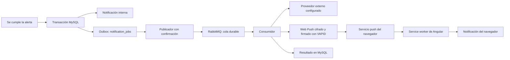

# Notificaciones Web Push con RabbitMQ

## Qué se añadió

Se implementó un canal Web Push y una cola RabbitMQ, activables con el complemento
`compose.notificaciones.yaml`. La bandeja interna sigue guardada en MySQL y funciona
aunque el navegador no autorice push o el proveedor esté caído.

El flujo anterior, basado en un ejecutor en memoria, se conserva para ejecutar la
aplicación sin el complemento. **Con la cola activada, ese ejecutor se deshabilita**:
el consumidor RabbitMQ se encarga del aviso externo y del envío Web Push.



La implementación utiliza Spring AMQP, RabbitMQ, `web-push` para cifrado AES128GCM
y firma VAPID, y el cliente HTTP de Java para limitar el envío a ocho segundos.
El frontend utiliza `SwPush` y el service worker de Angular ya presente en el proyecto.
No necesita una cuenta de Firebase para generar las claves VAPID.

## Cómo levantarlo en esta instalación

Desde la raíz del proyecto, con Docker Desktop abierto:

1. Solo la primera vez, generar las claves y credenciales:

```powershell
node scripts/generar-config-push.mjs
```

El archivo `.env.push` ya fue generado durante la implementación local. Si existe,
el script se detiene para no sobrescribirlo: simplemente continuar al siguiente
paso. El archivo está ignorado por Git y contiene las claves VAPID y la contraseña
de RabbitMQ. No se imprime su contenido ni se modifica el `.env` del Marketplace.

2. Reconstruir y levantar los servicios con el complemento:

```powershell
docker compose --env-file .env --env-file .env.push -p marketplace-pruebas -f compose.yaml -f compose.notificaciones.yaml up -d --build backend frontend rabbitmq
```

Para conservar también el perfil de pagos de demostración:

```powershell
docker compose --env-file .env --env-file .env.push -p marketplace-pruebas -f compose.yaml -f compose.pagos-demo.yaml -f compose.notificaciones.yaml up -d --build backend frontend rabbitmq
```

3. Comprobar los servicios:

```powershell
docker compose --env-file .env --env-file .env.push -p marketplace-pruebas -f compose.yaml -f compose.notificaciones.yaml ps
```

Esperar al arranque del backend y RabbitMQ. Si RabbitMQ todavía no está listo, el
Marketplace puede arrancar y conserva los eventos pendientes para reintentarlos.

## Activar push en el navegador

1. Usar **Chrome normal**, no incógnito, para la cuenta compradora. Abrir
   `http://localhost:4300/` o una URL HTTPS válida y estable. Los navegadores limitan
   o bloquean las suscripciones push en sesiones privadas.
2. Iniciar sesión y abrir el icono de mensajes del encabezado.
3. Pulsar **Activar notificaciones del navegador** y aceptar el permiso de Chrome.
4. Comprobar el mensaje de activación. La autorización del navegador y el registro
   en el backend son necesarios; tener el permiso concedido por sí solo no basta.
5. Crear una alerta nueva, con una condición todavía no cumplida.
6. En otra sesión, como vendedor, cambiar el precio o reponer la variante agotada.
7. Observar el aviso del navegador y la notificación interna. Pulsar el aviso abre
   el Marketplace con la bandeja de notificaciones; su contenido exige sesión válida.

El botón de activación aparece cuando el canal está configurado y el service worker
está habilitado. Se verifica con el **build de producción servido por Docker**:
`npm start` usa modo desarrollo y no habilita el service worker.

Si se rechazó el permiso, cambiarlo desde la configuración del sitio en Chrome y
volver a activar. Windows también puede ocultar avisos mediante No molestar o su
configuración de notificaciones. Web Push permite recibir avisos con la pestaña
cerrada cuando el navegador y el sistema lo permiten; no garantiza su aparición
con el navegador completamente detenido.

Una URL de túnel nueva constituye otro origen: requiere otro permiso y suscripción.
Para la demostración local conviene mantener `localhost` o una dirección HTTPS
estable durante toda la prueba. Las claves VAPID deben conservarse entre reinicios;
regenerarlas invalida las suscripciones ligadas a la clave anterior.

## Cola, reintentos y garantías

- `notification_jobs` se inserta en la misma transacción que la notificación interna
  creada por `PublishNotificationUseCase`. Un rollback no deja un evento pendiente
  ni provoca un envío externo.
- El publicador toma filas con bloqueo y `SKIP LOCKED`, publica mensajes persistentes
  y espera confirmación de RabbitMQ antes de marcar `PUBLISHED`. La cola y su volumen
  son durables. Una caída antes de confirmar deja el evento recuperable en MySQL.
- El mensaje contiene únicamente el identificador de la notificación. Los datos se
  consultan desde MySQL y no se deserializan objetos Java recibidos del broker.
- El consumidor reclama el trabajo mediante una actualización condicional y un
  bloqueo temporal de 120 segundos. Si muere, el publicador puede recuperarlo después
  de ese plazo. El resultado queda en `DONE`, `RETRY` o `FAILED`.
- Los fallos se reintentan hasta cinco veces por defecto, con espera creciente de
  10, 20, 30… segundos. Después se envía el mensaje a `marketplace.notifications.dead`.
- Cada dispositivo tiene un registro en `push_deliveries`; los ya marcados `SENT`
  se omiten en reintentos posteriores. Un endpoint 404 o 410 se elimina porque ya
  no es una suscripción válida.
- La entrega distribuida es **al menos una vez**, no exactamente una vez: si un
  proveedor acepta el aviso y el proceso cae antes de guardar el resultado, podría
  repetirse. La clave de evento y los registros evitan duplicados normales; el `tag`
  del aviso permite al navegador sustituir la misma notificación.
- Activar este complemento no reenvía automáticamente todas las notificaciones
  históricas; se genera la outbox para las nuevas publicaciones del módulo común.

El resultado `DONE` no demuestra por sí solo que hubo push: puede no haber ningún
dispositivo autorizado. Para demostrar un envío, consultar también `push_deliveries`.
`SENT` significa aceptación del servicio push, no una confirmación de que la persona
leyó el aviso. El proveedor externo simulado y Web Push son canales distintos.

## Privacidad y permisos

La API de suscripciones exige sesión, rol comprador o vendedor y CSRF en escrituras.
La cuenta y el destinatario se obtienen del servidor. La clave VAPID privada nunca
se envía al frontend. Los endpoints push y las claves de suscripción no se registran
en logs ni en `localStorage`.

Cada suscripción se asocia a una sesión JDBC. Al cerrar o revocar esa sesión, la
clave foránea elimina la suscripción. Los envíos excluyen sesiones vencidas,
cuentas inactivas, roles retirados y vendedores que ya no pertenecen a la tienda.
Un cambio de cuenta en la misma sesión no autoriza avisos para la cuenta anterior.
Se admiten como máximo cinco suscripciones por cuenta.

El aviso visible contiene únicamente «Marketplace» y un mensaje genérico. Los
detalles del producto o pedido se consultan al abrir la aplicación, protegiendo las
pantallas bloqueadas y dispositivos compartidos. Un aviso que el proveedor ya
aceptó antes del cierre de sesión podría aparecer después; sigue siendo genérico.

Los endpoints admitidos pertenecen a los servicios de Chrome/FCM, Firefox, Apple y
Windows, requieren HTTPS y no admiten redirecciones. No se permite registrar un
destino arbitrario, una IP local o una URL interna para que el backend la consulte.

## Comprobarlo en RabbitMQ y MySQL

Abrir `http://localhost:15672/`. El usuario y contraseña están en `.env.push`.
En **Queues**, observar `marketplace.notifications` y `marketplace.notifications.dead`.
Una cola vacía es normal si el consumidor procesó todos sus mensajes.

En MySQL, estas consultas no exponen endpoints ni claves:

```sql
SELECT n.id, n.type, n.title, j.status AS estado_cola,
       j.attempts, j.last_error, j.available_at, j.updated_at
FROM notifications n
JOIN notification_jobs j ON j.notification_id=n.id
ORDER BY n.created_at DESC LIMIT 20;

SELECT n.id AS notificacion_id, d.subscription_id,
       d.status AS estado_push, d.attempts, d.updated_at
FROM notifications n
JOIN push_deliveries d ON d.notification_id=n.id
ORDER BY d.updated_at DESC LIMIT 20;

SELECT id, account_id, recipient_type, recipient_id, created_at
FROM push_subscriptions ORDER BY created_at DESC;
```

Para demostrar recuperación, detener solo RabbitMQ, producir una alerta y consultar
su notificación interna y trabajo `PENDING`. Después arrancar el broker y comprobar
que el trabajo se procesa. Usar los mismos archivos y `--env-file` del comando de
arranque; no eliminar volúmenes para hacer esta prueba.

Un administrador puede reactivar un trabajo `FAILED` con
`POST /api/admin/notifications/jobs/{id}/retry`, usando sesión y CSRF. Se reinicia
el contador del trabajo y se conservan los dispositivos ya enviados. Resolver la
causa antes de reintentar. El mensaje histórico de la cola de fallos no desaparece
automáticamente por esa acción administrativa.

## Archivos principales

| Archivo | Función |
| --- | --- |
| [V42__notification_outbox_and_web_push.sql](../../backend/demo/src/main/resources/db/migration/V42__notification_outbox_and_web_push.sql) | Tablas de trabajos, suscripciones y entregas por dispositivo. |
| [JdbcNotificationRepository.java](../../backend/demo/src/main/java/com/transformersas/marketplace/notifications/infrastructure/persistence/repository/JdbcNotificationRepository.java) | Registra la outbox dentro de la transacción del aviso. |
| [NotificationQueueConfiguration.java](../../backend/demo/src/main/java/com/transformersas/marketplace/notifications/infrastructure/queue/NotificationQueueConfiguration.java) | Cola durable y ruta de fallos. |
| [NotificationOutboxPublisher.java](../../backend/demo/src/main/java/com/transformersas/marketplace/notifications/infrastructure/queue/NotificationOutboxPublisher.java) | Publicación recuperable con confirmación del broker. |
| [NotificationQueueConsumer.java](../../backend/demo/src/main/java/com/transformersas/marketplace/notifications/infrastructure/queue/NotificationQueueConsumer.java) | Reclamo de trabajos, envío y política de reintentos. |
| [NotificationRetryController.java](../../backend/demo/src/main/java/com/transformersas/marketplace/notifications/infrastructure/queue/NotificationRetryController.java) | Recuperación administrativa de trabajos fallidos. |
| [PushController.java](../../backend/demo/src/main/java/com/transformersas/marketplace/notifications/infrastructure/push/PushController.java) | Configuración pública VAPID, alta, estado y baja de suscripciones autenticadas. |
| [PushSubscriptionService.java](../../backend/demo/src/main/java/com/transformersas/marketplace/notifications/infrastructure/push/PushSubscriptionService.java) | Validación, propiedad y vínculo con sesiones. |
| [PushSettings.java](../../backend/demo/src/main/java/com/transformersas/marketplace/notifications/infrastructure/push/PushSettings.java) | Configuración del canal. |
| [WebPushTransport.java](../../backend/demo/src/main/java/com/transformersas/marketplace/notifications/infrastructure/push/WebPushTransport.java) | Cifrado y firma VAPID, envío HTTP con timeout y sin redirecciones. |
| [BrowserPushTransport.java](../../backend/demo/src/main/java/com/transformersas/marketplace/notifications/infrastructure/push/BrowserPushTransport.java) | Contrato para sustituir el servicio push en pruebas. |
| [PushDeliveryService.java](../../backend/demo/src/main/java/com/transformersas/marketplace/notifications/infrastructure/push/PushDeliveryService.java) | Envío a dispositivos elegibles y resultado por suscripción. |
| [push.service.ts](../../frontend/src/app/notificaciones/push.service.ts) | Consentimiento, suscripción `SwPush`, activación y desactivación. |
| [notificaciones.component.ts](../../frontend/src/app/notificaciones/notificaciones.component.ts) | Botones de push dentro de la bandeja existente. |
| [main.ts](../../frontend/src/main.ts) | Registro inmediato del service worker en producción. |
| [app.component.ts](../../frontend/src/app/app.component.ts) | Inicialización del canal y apertura de bandeja desde el enlace push. |
| [compose.notificaciones.yaml](../../compose.notificaciones.yaml) | Servicios y variables para levantar esta integración. |
| [generar-config-push.mjs](../../scripts/generar-config-push.mjs) | Genera configuración local con criptografía de Node, sin dependencias adicionales. |

## Pruebas

Desde `backend/demo`, con Java 21, Maven y Docker:

```powershell
mvn.cmd '-Dtest=WebPushTransportTests,PushQueueIntegrationTests,NotificationsIntegrationTests,NotificationInboxTests' test
```

Desde `frontend`:

```powershell
npm.cmd run build
npx.cmd playwright test --config=playwright.push.config.ts --project=chrome --reporter=list
```

La integración utiliza RabbitMQ y MySQL reales en contenedores aislados. El servicio
push externo se sustituye por respuestas controladas: aceptación, 503 y 410. También
se verifica el cifrado y la cabecera VAPID sin efectuar llamadas externas.

La prueba del navegador usa el service worker de producción real. Controla la
suscripción para no depender de un registro real en FCM e inyecta un push mediante
Chrome DevTools Protocol para comprobar que el worker muestra la notificación.
No equivale a haber verificado una entrega real completa a través de Google, Apple
o Mozilla. Esa comprobación se realiza manualmente con permiso del usuario y el
entorno descrito anteriormente.

### Resultados locales (4 de noviembre de 2026)

| Verificación | Resultado |
| --- | --- |
| Push y cola: `WebPushTransportTests`, `PushQueueIntegrationTests` | 11 pruebas correctas; incluye concurrencia entre cuentas, sesión vencida, broker real, reintentos y cola de fallos. |
| Notificaciones internas: `NotificationsIntegrationTests`, `NotificationInboxTests` | 17 pruebas correctas. |
| Regresión: `NotificationsHttpIntegrationTests`, `AfterCommitNotificationDispatcherTests`, `FavoritesIntegrationTests` | 23 pruebas correctas. |
| Push en Chrome con service worker de producción | 4 pruebas correctas con envío controlado. |
| Regresión general en Chrome | 96 pruebas correctas inicialmente; otras 2 agotaron el tiempo al crear el contexto del navegador y pasaron al repetirlas con un trabajador. |
| Compilación de producción del frontend | Correcta. |

La recepción mediante un proveedor push real queda pendiente de la prueba manual
con el navegador del usuario; no se presenta como una entrega externa verificada.

## Fuentes técnicas

- [Angular: notificaciones push](https://angular.dev/ecosystem/service-workers/push-notifications).
- [Spring AMQP: publicación y confirmaciones](https://docs.spring.io/spring-amqp/reference/amqp/template.html).
- [RabbitMQ: publicación fiable](https://www.rabbitmq.com/tutorials/tutorial-seven-java).
- [Biblioteca Web Push para Java](https://github.com/web-push-libs/webpush-java).

## Actualizaci?n tras integrar main

La migraci?n de push usa V42: main ya contiene V40 (coste de producto) y V41
(suspensiones). En bases nuevas se aplican las tres sin duplicar versiones.
Si una base local ya aplic? `V40__notification_outbox_and_web_push.sql`, no debe
iniciarse como si fuera una instalaci?n nueva: su historial Flyway necesita
reconciliaci?n espec?fica antes del arranque. No ejecutar `repair` a ciegas ni
borrar vol?menes para resolverlo. Comprobar primero el historial, sin modificarlo:

```sql
SELECT installed_rank, version, description, script, checksum, success
FROM flyway_schema_history
WHERE version IN ('40', '41', '42')
ORDER BY installed_rank;
```

El cambio de nombre no modifica autom?ticamente el historial de bases existentes.
