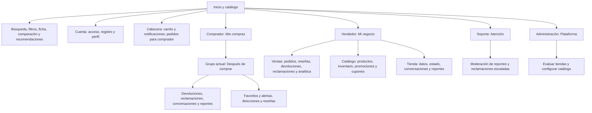

# Evaluación de usabilidad del Marketplace completo

**Actualización del protocolo, 16/11/2026:** usar la
[guía RNF-025 a RNF-030](usabilidad/guia-rnf-025-a-030.md) para los criterios de
aceptación del Excel compartido. Especifica las cinco personas, el umbral 4/5,
el promedio ≥4/5 y las comprobaciones de formularios, escritorio, accesibilidad
y navegadores. No agrega resultados de sesiones ni cambia los hallazgos previos.
Las metas propuestas más adelante no sustituyen esos criterios.

Fecha de inspección: 14 de noviembre de 2026. Alcance: aplicación completa, independientemente del autor de cada caso de uso.

**Estado:** inspección estática de navegación realizada; protocolo y formatos preparados. No se han ejecutado sesiones con participantes ni se certifica el cumplimiento global del atributo. Los mapas describen accesos presentes en el repositorio, no una verificación de que todas las operaciones funcionen en el entorno desplegado.

## 1. Documentos y criterios de comparación

- [Ejercicio por contenedor C4 y cinco planos](../arquitectura/usabilidad-arquitectura-informacion.md).
- [Presentación visual](../sustentacion/usabilidad-marketplace.html) y [PDF](../sustentacion/usabilidad-marketplace.pdf): propuestas y ejemplos, no pantallas nuevas desplegadas.
- `docs/arquitectura/Marketplace_ASR_Final.docx`: documento arquitectónico disponible; no se inventa una numeración oficial de ASR de usabilidad.
- Diapositivas proporcionadas: `14. Usability.pdf`, especialmente páginas 25–43.

| Criterio | Procedencia y alcance | Cómo comprobarlo | Estado de esta evaluación |
| --- | --- | --- | --- |
| RNF-027: el 100 % de campos inválidos muestra un mensaje específico junto al campo y conserva los demás datos válidos cuando sea posible | Requisitos suministrados y trazabilidad existente de CU-05, CU-06 y CU-08 | Inventariar cada formulario; probar cada regla inválida por separado, documentar excepciones de conservación | Pendiente de evaluación transversal; evidencia de algunos CU no prueba todos los formularios |
| RNF-003/010: permisos por rol y privacidad | Requisitos suministrados | Tareas por rol; comprobar que no se ofrecen datos ajenos ni se invita a acciones no autorizadas; respaldar con pruebas de autorización | Revisión de entradas por rol realizada; comprobación dinámica pendiente |
| RNF-018: p95 ≤ 2 segundos con hasta 100 usuarios virtuales en operaciones indicadas por el requisito | Requisito de rendimiento, no tiempo para aprender una tarea | Medición de carga separada, identificando entorno y operación | No ejecutada en este trabajo; no confundir con cronómetro de participantes |
| Aprendizaje, eficiencia, recordación, errores y satisfacción | Dimensiones de las diapositivas, página 25 | Primer intento, repetición, retorno 24–48 h, recuperación y valoración 1–5 | No medido con participantes |
| ≥90 % de éxito sin ayuda, cero errores críticos y mediana de satisfacción ≥4/5 | Metas propuestas del ejercicio, por acordar con profesor/equipo | Reportar numerador, denominador y resultados por rol; no ocultar tareas bloqueadas | No son criterios oficiales adicionales del SAD ni resultados obtenidos |

Antes de cerrar el informe, contrastar la versión vigente del SAD del equipo con esta matriz: registrar versión, sección, texto y responsable de cada criterio. Si hay diferencias, actualizar la matriz y conservar la justificación. El material disponible no autoriza afirmar que se revisó un SAD adicional que no está en el repositorio.

## 2. Arquitectura de información existente

La aplicación utiliza mayormente paneles abiertos desde una pantalla raíz. Los nombres siguientes son **recorridos de interfaz**, no rutas URL independientes. La visibilidad del menú depende del rol activo. Las restricciones del servidor siguen siendo necesarias.

| Rol / módulo | Acceso actual e información principal | Tareas del protocolo |
| --- | --- | --- |
| Visitante / descubrimiento | Inicio → buscador/filtros → ficha; recomendaciones y comparación desde catálogo | V01, V02 |
| Acceso y cuenta | Icono de cuenta → acceso/recuperación; botón de registro; perfil y preferencias para autenticados | V03, C01 |
| Comprador / compra | Cabecera → carrito → entrega/resumen → pasarela → resultado | C02 |
| Comprador / pedidos y seguimiento | Cabecera → Mis pedidos → detalle, comprobante, acciones y seguimiento según estado | C03 |
| Comprador / direcciones | Mis compras → Mis direcciones; también desde checkout | C04 |
| Comprador / favoritos y alertas | Corazón en producto; Mis compras → Mis favoritos y alertas | C05 |
| Comprador / reseñas | Mis compras → Mis reseñas; producto comprado de pedido entregado | C06 |
| Comprador / devolución y reclamación | Mis compras → Mis devoluciones / Mis reclamaciones; acciones contextuales del pedido | C07 |
| Comprador y vendedor / comunicación | Cabecera → notificaciones; menú → Conversaciones / Mis reportes | C08, S06 |
| Vendedor / publicaciones | Mi negocio → Catálogo → Mis productos | S01 |
| Vendedor / inventario | Mi negocio → Catálogo → Inventario | S02 |
| Vendedor / promociones | Mi negocio → Catálogo → Promociones y cupones | S03 |
| Vendedor / atención de ventas | Mi negocio → Ventas → Pedidos recibidos, Reseñas recibidas, Devoluciones recibidas, Reclamaciones | S04, S05 |
| Vendedor / indicadores | Mi negocio → Ventas → Analítica | S07 |
| Vendedor / tienda | Mi negocio → Tienda → Mi tienda / Estado de mi tienda | S08 |
| Soporte / casos | Soporte → Atención → Moderación de reportes / Reclamaciones escaladas | P01, P02 |
| Administrador / tiendas | Administración → Plataforma → Evaluar tiendas | A01 |
| Administrador / catálogo | Administración → Plataforma → Configurar catálogo | A02 |
| Operador / inicio auxiliar | Iniciador Windows → preparación → disponibilidad → navegador | O01 |

La propuesta de reorganización está separada en el documento C4: no se presenta como navegación actual. Se incluyen promociones, inventario y analítica aunque no pertenezcan a CU-01 a CU-06.

## 3. Preparación de las sesiones

1. Designar un coordinador y un observador; asignar un responsable de preparar los datos de cada módulo. Evaluar tareas sin atribuir fallos a la persona que desarrolló el módulo.
2. Registrar commit, configuración activa, navegador, dispositivo, fecha y URL de la sesión. Usar el mismo punto inicial al comparar versiones. No registrar secretos de `.env`.
3. Preparar cuentas ficticias separadas de comprador, vendedor, soporte y administrador. Usar compradores y tiendas diferentes para comprobar aislamiento. No compartir sus contraseñas en evidencias.
4. Preparar productos visibles, uno agotado con variantes, un pedido entregado, uno en proceso, una devolución/reclamación, un reporte elegible, tiendas con/sin antecedentes, promociones y ventas para analítica. Anotar identificadores en la ficha de preparación. Una lista vacía sin datos no demuestra que un flujo de decisión completo funciona.
5. Para pagos utilizar exclusivamente sandbox. Para eliminar, suspender o moderar, usar datos desechables y un entorno de pruebas. Preparar casos antes de la sesión para que el participante no tenga que crearlos todos.
6. Pedir consentimiento para observación y, por separado, para grabación. Usar códigos P01, P02…; no recoger nombres, documentos ni información personal innecesaria.
7. Propuesta exploratoria: cinco compradores y al menos una persona representativa de visitante, vendedor, soporte, administrador y operador. Si hay menos, declarar la limitación. Evitar que cada persona evalúe únicamente su propio desarrollo. No asignar tareas administrativas a alguien que desconoce el trabajo de ese rol.
8. Repartir tareas en bloques de 30–45 minutos para evitar fatiga; no exigir a una persona recorrer todo el proyecto. Reservar retorno de 24–48 horas para recordación.

Texto inicial del moderador: «Estamos evaluando la aplicación, no tus conocimientos. Intenta realizar la tarea como lo harías normalmente y cuéntanos qué esperas encontrar. Puedes detenerte cuando quieras». No enseñar el mapa propuesto antes de medir la navegación actual.

## 4. Tarjetas de tareas para participantes

Leer solo la columna “Consigna”; los recorridos y criterios son para el observador. Preguntar “¿qué esperabas que ocurriera?” sin indicar el botón. La ayuda que revela un destino se registra y deja de contar como éxito sin ayuda.

| ID / rol | Consigna sin indicar botones | Datos previos / resultado verificable |
| --- | --- | --- |
| V01 visitante | Encuentra un producto de una categoría y dentro de un presupuesto dado; identifica precio y disponibilidad | Productos visibles y presupuesto escrito; ficha correcta |
| V02 visitante | Compara dos alternativas y explica cuál elegirías y por qué | Dos productos comparables; localizar comparación y entender diferencias |
| V03 visitante | Averigua cómo crear una cuenta y cómo recuperar acceso si olvidas tu contraseña | Correo ficticio controlado; reconocer pasos sin exponer tokens |
| C01 comprador | Cambia una preferencia de tu cuenta y comprueba si se conserva al volver | Cuenta propia; cambio confirmado y visible |
| C02 comprador | Prepara una compra con una dirección válida y explica qué ocurrió con el pago de prueba | Carrito y sandbox; total comprendido; distinguir aprobado, pendiente y rechazado en sesiones separadas |
| C03 comprador | Localiza una compra y averigua su estado, comprobante y siguiente acción disponible | Pedido en proceso y otro finalizado; interpretar estado y seguimiento/cancelación según corresponda |
| C04 comprador | Guarda una dirección, corrige un teléfono inválido y elige una predeterminada; intenta retirar otra usada por un pedido en proceso | Datos ficticios; mensajes por campo, conservación y restricción explicada |
| C05 comprador | Guarda un producto y pide que te avisen al bajar su precio; después pausa el aviso | Precio objetivo inferior al actual; alerta activa y luego pausada; variante agotada para otra sesión |
| C06 comprador | Opina sobre un producto recibido y después modifica tu valoración | Pedido entregado propio; calificación, comentario/imagen opcionales; edición reconocible |
| C07 comprador | Solicita una devolución y encuentra dónde seguirla; identifica cómo reclamar si hay un problema | Compra elegible y caso preparado; reconocer estado y siguiente paso sin duplicar solicitud |
| C08 comprador | Encuentra un aviso reciente, abre el producto relacionado y localiza cómo contactar al vendedor o seguir un reporte | Aviso, conversación y reporte propios; distinguir bandeja interna y permiso push |
| S01 vendedor | Publica un producto de prueba y luego corrige su precio | Categoría activa; formulario con error deliberado; datos válidos conservados |
| S02 vendedor | Actualiza existencias y averigua cómo corregir un archivo de inventario inválido | Producto propio y archivos válidos/inválidos ficticios; identificar resultado y corrección |
| S03 vendedor | Prepara una promoción o cupón y explica sus condiciones antes de activarlo | Fechas y reglas de ejemplo; comprender vigencia y efecto |
| S04 vendedor | Encuentra un pedido pendiente y determina cómo avanzar su atención | Pedido elegible propio; acciones y consecuencias comprensibles |
| S05 vendedor | Responde una reseña y encuentra una devolución o reclamación que requiere atención | Reseña/caso propio; distinguir contexto y acción pendiente |
| S06 vendedor | Encuentra una conversación y consulta el estado de un reporte propio | Mensaje y reporte preparados; reconocer destinatario y estado |
| S07 vendedor | Obtén las ventas de un periodo y explica los indicadores y cómo exportarlos | Ventas de prueba; filtros, unidades y periodo reconocibles; lista vacía en segunda sesión |
| S08 vendedor | Actualiza un dato de tu tienda y averigua si tiene alguna restricción | Tienda ficticia; cambio guardado; interpretación de estado sin confundirlo con inventario |
| P01 soporte | Encuentra un reporte pendiente, identifica su contenido y prepara una decisión explicando su consecuencia | Reporte elegible; contexto, motivo y confirmación; cancelar antes de confirmar en primera pasada |
| P02 soporte | Localiza una reclamación escalada y determina qué información necesitas para atenderla | Caso preparado; estado, antecedentes pertinentes y siguiente acción |
| A01 administrador | Averigua qué tiendas requieren evaluación y qué significa que no aparezcan tiendas | Casos con y sin antecedentes; no confundir ausencia de elegibles con ausencia de tiendas |
| A02 administrador | Crea o modifica una categoría de prueba y explica el efecto de desactivarla | Datos desechables; validación y consecuencias; confirmación controlada |
| O01 operador | Inicia la demostración y explica si está disponible o qué debes resolver | Entorno preparado; distinguir preparación, espera, error y disponibilidad |

Para cada familia de formulario añadir una ejecución de errores: vacío obligatorio, formato inválido, longitud/rango, selección ausente y fallo recuperable cuando pueda provocarse de manera controlada. No se afirma RNF-027 al 100 % a partir de un solo formulario correcto.

## 5. Registro y medición

Usar [sesiones-usabilidad.csv](usabilidad/sesiones-usabilidad.csv), [campos-usabilidad.csv](usabilidad/campos-usabilidad.csv) y [hallazgos-usabilidad.csv](usabilidad/hallazgos-usabilidad.csv). Son plantillas, no resultados. Abrir con Excel o un editor; crear una fila por intento, campo o hallazgo respectivamente.

- Inicio: después de leer la consigna, con la pantalla inicial acordada. Fin: la persona identifica el resultado correcto, abandona o alcanza el límite previamente acordado. Registrar interrupciones y separar espera técnica de interacción.
- Resultado: `EXITO_SIN_AYUDA`, `EXITO_CON_AYUDA`, `FALLO`, `ABANDONO` o `BLOQUEADA_POR_ENTORNO`. No convertir una tarea bloqueada en aprobada ni omitirla del informe; explicar su tratamiento al calcular tasas.
- Éxito sin ayuda = intentos exitosos sin ayuda / intentos evaluables × 100. Informar ambos números y resultados por tarea/rol; un promedio global no debe ocultar un rol que no puede trabajar.
- Registrar activaciones, errores, ayudas, tiempo y valoración de facilidad 1–5 al finalizar cada tarea, con comentario libre. Una valoración aislada no es un cuestionario estandarizado ni un índice SUS.
- Recordación: repetir una tarea comparable 24–48 horas después sin instrucciones nuevas. Conservar ambos intentos y su intervalo.
- RNF-027: contar reglas/campos inválidos con mensaje específico junto al control y conservación esperada. Denominador explícito = reglas probadas; no llamar “todos” a una muestra. Documentar conservación no aplicable, por ejemplo secretos que deban reingresarse, con justificación.
- Evidencias: `P03-C04-antes.png`, `P03-C04-error.png`, `P03-C04-despues.png`; capturar contexto y resultado, ocultando datos personales. Guardar grabaciones consentidas fuera de Git, con acceso y plazo de eliminación acordados. No versionar contraseñas, tokens, endpoints push ni grabaciones crudas.

## 6. Hallazgos de la inspección estática realizada

Severidad preliminar: alta impide o induce una acción importante incorrecta; media dificulta localizar/entender; baja añade fricción menor. Debe revisarse al observar participantes. Estos hallazgos no son resultados de sesiones humanas.

| ID | Evidencia inspeccionada | Hallazgo / hipótesis | Prioridad preliminar / mejora propuesta |
| --- | --- | --- | --- |
| H01 | `app.component.ts`, `MENUS_POR_ROL.COMPRADOR` | Favoritos, direcciones y conversaciones están bajo “Después de comprar”; la agrupación no representa el momento de uso | Media: separar explorar/guardar, compras/entregas y posventa; validar con C04/C05 |
| H02 | `app.component.html`, accesos de registro/perfil | “Crear cuenta de comprador / Habilitar COMPRADOR” mezcla registro y rol técnico, incluso junto al perfil autenticado | Media: redacción contextual por estado de cuenta, conservando las reglas de habilitación; validar V03/C01 |
| H03 | Cabecera en `app.component.html` | El icono de conversación abre notificaciones; “Conversaciones” está en otro acceso | Media: comprobar si se confunden mensajes y avisos; etiquetar o distinguir ambos conceptos; validar C08/S06 |
| H04 | `MENUS_POR_ROL` y componentes de raíz | Muchos destinos se abren como paneles en una raíz; no debe asumirse que cada destino tiene URL compartible o historial propio | Hipótesis a verificar: regreso, cierre, foco y conservación del contexto en todos los roles; proponer cambios solo con evidencia |
| H05 | Documentación existente de CU-08, matriz RNF-027 | Se declara validación parcial y mensajes a nivel panel; no hay evidencia transversal de mensaje junto a cada campo | Prioridad de auditoría alta: completar inventario de formularios y reglas antes de declarar 100 % |

Referencia positiva: el formulario de direcciones inspeccionado ya aparece antes de las tarjetas; conservarlo y comprobar con usuarios. La lista vacía de tiendas ya explica el criterio de elegibilidad; medir comprensión antes de cambiar la regla del catálogo.

No se modifican menús ni reglas globales basándose únicamente en estas hipótesis: primero registrar línea base; luego aplicar mejoras priorizadas y repetir tareas. Esto permite comparar la versión actual y la propuesta sin inventar una mejora obtenida.

## 7. Relación con contenedores C4

| Contenedor | Responsabilidad que se evalúa | Evidencia sin mostrar código |
| --- | --- | --- |
| C1 web | Organización por rol, descubrimiento, controles, foco, lectura, errores y retorno | Mapa actual/propuesto, capturas y recorrido de tareas |
| C2 backend | Validaciones, permisos, estados y respuestas recuperables | Resultado comprensible, restricción explicada, datos válidos conservados en interfaz |
| C3 MySQL | Información confirmada consistente, propiedad e historia | Volver a abrir datos; cambiar dirección guardada sin alterar entrega histórica |
| C4 RabbitMQ opcional | Avisos desacoplados y recuperación sin bloquear tareas | Bandeja interna accesible aunque el envío externo falle; no equiparar encolado con lectura |
| C5 iniciador Windows auxiliar | Preparación y siguiente acción del operador | Etapas visibles y disponibilidad; no es un servicio Docker ni pantalla del comprador |

Los cinco planos completos se mantienen en el documento arquitectónico enlazado. No se deben aplicar cuestionarios de satisfacción a MySQL o RabbitMQ como si fueran pantallas del comprador.

## 8. Resultado actual y cierre del informe

| Actividad / criterio de aceptación | Resultado realmente obtenido |
| --- | --- |
| Identificar principales módulos y roles | Inventario estático y mapa actual preparados para todos los roles presentes |
| Mapas y estructura de información | Mapa actual en este informe; propuesta y vista C4 en los artefactos vinculados |
| Evaluar claridad y consistencia | Inspección estática con cinco hallazgos; comprensión real no medida |
| Diseñar tareas representativas | 24 tarjetas: visitante, comprador, vendedor, soporte, administrador y operador |
| Ejecutar pruebas con usuarios | Pendiente; ninguna sesión inventada |
| Resultados, evidencias y comparación con SAD | Formatos y criterios preparados; falta diligenciar resultados y versión definitiva del SAD |
| Mejoras y repetición de pruebas | Propuestas priorizadas; implementación global y validación posterior pendientes |

Para cerrar: (1) acordar criterios y datos con el equipo; (2) completar sesiones por rol; (3) adjuntar evidencia anonimizada; (4) priorizar e implementar correcciones; (5) repetir tareas equivalentes; (6) informar por criterio `CUMPLE`, `NO_CUMPLE` o `NO_EVALUADO`, citando evidencia y límites. No declarar “100 % de usabilidad” por cobertura Java, pruebas E2E o por tener un PDF.

Conclusión de esta entrega: existe una base de evaluación transversal y auditable, con arquitectura de información actual, tareas y hallazgos de inspección. Todavía no hay resultados de aprendizaje, satisfacción o recordación de participantes que permitan concluir cumplimiento global.
