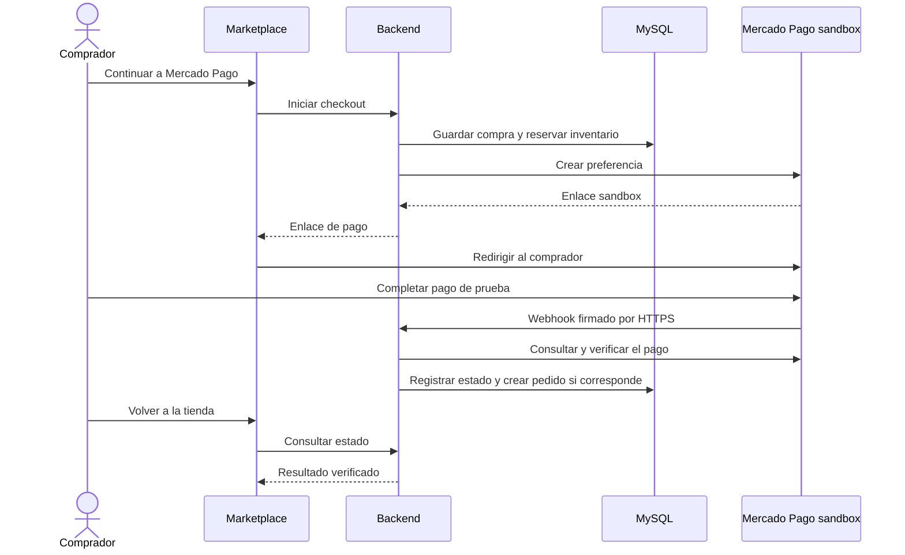

# CU-03: explicación de la pasarela de pagos

## Qué se implementó

El Marketplace integra **Mercado Pago Checkout Pro mediante la API de Preferencias, en entorno de pruebas (sandbox)**. El comprador prepara su compra en el Marketplace y pulsa **Continuar a Mercado Pago**. Entonces se abre la página de Mercado Pago para elegir el medio de pago y completar la operación.

Antes, el desplegable del Marketplace permitía seleccionar resultados simulados, como aprobado, rechazado o pendiente. Ahora el resultado se consulta al proveedor y se verifica en el backend. El comprador no elige el estado de la compra en la aplicación.

Se utiliza la infraestructura externa de Mercado Pago con cuentas y tarjetas de prueba. **No se realizan cobros reales y esta entrega no habilita pagos de producción.**

## Qué servidores se levantan

| Componente | Función | Dónde se ejecuta |
| --- | --- | --- |
| Frontend Angular servido por Nginx | Muestra el catálogo, carrito y resultado; envía las solicitudes `/api/` al backend | Contenedor Docker local, puerto 4300 por defecto |
| Backend Spring Boot | Calcula el importe, crea el checkout, valida el pago y genera el pedido | Contenedor Docker local, puerto 8080 por defecto |
| MySQL | Guarda compras, pedidos, productos, reservas y sesiones | Contenedor Docker local, puerto 3307 del equipo por defecto |
| Túnel Cloudflare | Publica una dirección HTTPS que llega al frontend y a su proxy de API | Proceso adicional que debe permanecer activo |
| Mercado Pago sandbox | Presenta el checkout y procesa operaciones de prueba | Servidores externos del proveedor |

**No se instala ni se levanta un servidor propio de Mercado Pago.** Se levantan los servidores del Marketplace y se conectan por HTTPS con la pasarela del proveedor.

## Cómo funciona una compra

1. El usuario inicia sesión con su cuenta del Marketplace, agrega productos de una sola tienda y selecciona dirección y envío.
2. El backend calcula el total y reserva inventario durante diez minutos. Guarda una copia de los productos, cantidades y precios de esa compra, denominada *snapshot*.
3. El backend solicita a Mercado Pago una **preferencia de pago**: la configuración de esa compra, con importe y referencia propios. El Access Token se utiliza únicamente en el backend.
4. El navegador abre el enlace sandbox proporcionado por Mercado Pago. Los datos de tarjeta se introducen en la pasarela, no en el Marketplace.
5. Mercado Pago envía una notificación al backend mediante un **webhook**, una llamada HTTP entre servidores. El backend valida su firma HMAC-SHA256.
6. El backend consulta el pago directamente a Mercado Pago y comprueba referencia de compra, receptor, moneda COP, importe y condición de pruebas.
7. Si está aprobado y la reserva sigue vigente, confirma el inventario y crea el pedido con sus productos. Las notificaciones repetidas no deben crear otro pedido para el mismo checkout.
8. Cuando el comprador vuelve al Marketplace, la interfaz consulta el estado al backend. Un texto como `status=approved` en la URL no basta para aprobar la compra.



## Estados que muestra el sistema

| Estado local | Significado |
| --- | --- |
| `PENDING` | Falta una aprobación confirmada. No se crea un pedido aprobado. Puede existir una reserva temporal de inventario. |
| `REJECTED` | El proveedor rechazó o canceló el intento. Puede reintentarse el checkout mientras la reserva esté vigente. |
| `APPROVED` | Se verificó la aprobación y se creó el pedido. |
| `REVIEW` | Requiere revisión, por ejemplo si el pago se aprobó después de vencer la reserva. No debe indicarse al comprador que pague otra vez. |

Cerrar la pestaña o volver a la tienda no equivale a cancelar un pago. Además, cancelar un intento en Mercado Pago es distinto de cancelar un pedido ya confirmado en el Marketplace.

## Cómo levantarlo para una demostración

Los comandos se ejecutan en PowerShell, desde la raíz del proyecto, con Docker Desktop abierto. Se mantiene el nombre de proyecto Docker `marketplace-pruebas` usado en esta instalación para reutilizar sus contenedores y su volumen de datos.

### 1. Iniciar el Marketplace

```powershell
docker compose -p marketplace-pruebas up -d --build
docker compose -p marketplace-pruebas ps
```

El frontend debe estar disponible en `http://localhost:4300`, salvo que se haya cambiado el puerto en `.env`. MySQL y el backend deben estar saludables.

### 2. Iniciar el túnel HTTPS

En otra terminal:

```powershell
docker run --rm cloudflare/cloudflared:latest tunnel --url http://host.docker.internal:4300
```

Copiar la dirección `https://...trycloudflare.com` que aparezca y mantener esta terminal abierta. Si se cambió el puerto del frontend, ajustar también el comando. El túnel permite que Mercado Pago alcance el backend local a través del proxy `/api/` del frontend.

### 3. Configurar las variables privadas

En **`.env`**, no en `.env.example`, completar:

```dotenv
MERCADOPAGO_ACCESS_TOKEN=TOKEN_DEL_VENDEDOR_DE_PRUEBA
MERCADOPAGO_COLLECTOR_ID=ID_NUMERICO_DEL_VENDEDOR_DE_PRUEBA
MERCADOPAGO_WEBHOOK_SECRET=SECRETO_DEL_WEBHOOK
MERCADOPAGO_RETURN_URL=https://TU-DIRECCION.trycloudflare.com/
MERCADOPAGO_NOTIFICATION_URL=https://TU-DIRECCION.trycloudflare.com/api/payments/mercadopago/webhook
```

El `COLLECTOR_ID` identifica al receptor del pago; no es el ID de la aplicación. El secreto del webhook se obtiene en la configuración de notificaciones de Mercado Pago Developers; es distinto del Access Token. `.env.example` conserva únicamente la plantilla sin secretos.

En Mercado Pago Developers, configurar la misma URL de notificaciones en el entorno de prueba y los eventos de pago correspondientes a esta integración con Preferencias, mostrados en el panel utilizado como **Pagos (legacy)**.

Aplicar las variables al contenedor:

```powershell
docker compose -p marketplace-pruebas up -d --force-recreate backend
```

Un túnel temporal puede dar una dirección diferente al reiniciarse. Si cambia, actualizar ambas URLs de `.env`, la URL del webhook en el panel y recrear el backend. `localhost` sirve para acceder desde el propio equipo, pero no es una dirección pública a la que Mercado Pago pueda enviar notificaciones.

### 4. Hacer una compra de prueba

1. Abrir la dirección HTTPS del túnel e iniciar sesión con una cuenta del **Marketplace**.
2. Preparar una compra y continuar a Mercado Pago.
3. En Mercado Pago, usar una **cuenta compradora de prueba**, distinta del vendedor de prueba, y los datos de tarjeta del proveedor. Esta cuenta es independiente de la del Marketplace.
4. Completar la operación antes de que venza la reserva de diez minutos.
5. Volver a la tienda y consultar el estado. Comprobar también los datos del backend y de MySQL.

## Cómo comprobarlo en la base de datos

Conectarse desde el cliente MySQL habitual al puerto configurado en `.env` —3307 por defecto— y a la base configurada por `DB_NAME`, que por defecto es `marketplace`. Utilizar las credenciales locales sin incluirlas en capturas ni documentos públicos.

Para consultar las últimas compras:

```sql
SELECT id, account_id, total, status, payment_id, order_id,
       expires_at, created_at, updated_at
FROM payment_checkouts
ORDER BY created_at DESC
LIMIT 20;
```

Para relacionar el pago con el pedido y el nombre del producto, sustituir la referencia por el UUID del checkout que se quiere revisar:

```sql
SELECT pc.id AS checkout_id, pc.status AS checkout_status,
       pc.payment_id, pc.total, pc.order_id,
       o.status AS order_status, o.transaction_id,
       oi.product_id, oi.product_name, oi.quantity, oi.unit_price
FROM payment_checkouts pc
LEFT JOIN orders o ON o.id = pc.order_id
LEFT JOIN order_items oi ON oi.order_id = o.id
WHERE pc.id = 'UUID_DEL_CHECKOUT';
```

Un checkout `APPROVED` debe tener `order_id` y líneas de producto; el pedido se crea con estado `CONFIRMED` y referencia de transacción `MP-` seguida del identificador del pago. Para una compra pendiente o rechazada sin pedido, los campos del pedido y sus productos aparecerán nulos por el `LEFT JOIN`.

Los productos de una compra que todavía no tiene pedido pueden consultarse en la copia persistida:

```sql
SELECT id, status, snapshot_json
FROM payment_checkouts
WHERE id = 'UUID_DEL_CHECKOUT';
```

Las consultas anteriores son de lectura. **No se deben cambiar estados con un `UPDATE` para demostrar que la integración funciona**: el resultado debe provenir de la consulta al proveedor y del procesamiento del backend.

## Seguridad y límites

- El Access Token y el secreto del webhook permanecen en el backend; no se entregan al navegador.
- No se guardan números de tarjeta ni códigos de seguridad en la aplicación.
- Esta integración no guarda datos en `localStorage` ni `sessionStorage`. Las compras se guardan en MySQL y la autenticación del Marketplace utiliza una cookie de sesión HttpOnly.
- Los endpoints del comprador exigen sesión y las operaciones de escritura requieren protección CSRF. El webhook utiliza su firma para autenticar la notificación.
- El backend acepta el enlace sandbox y verifica la condición de pruebas del receptor. Si el proveedor devuelve `live_mode=true`, solo se admite cuando una consulta adicional confirma que el dueño del token es el receptor configurado y tiene la etiqueta `test_user`.
- La integración admite una tienda por compra y un receptor de pruebas. No implementa reparto automático de pagos entre vendedores.
- Los reembolsos de transacciones de Mercado Pago requieren gestión desde el proveedor; no se presentan como completados mediante el simulador anterior. Tampoco está implementado el ciclo completo de contracargos y conciliación programada.

## Código y pruebas relacionados

| Archivo o componente | Responsabilidad |
| --- | --- |
| `MercadoPagoClient.java` | Comunicación con el proveedor y validaciones del pago y receptor. |
| `MercadoPagoCheckoutService.java` | Compra persistente, reservas, conciliación y creación del pedido. |
| `MercadoPagoController.java` | Endpoints del comprador y recepción del webhook firmado. |
| `MercadoPagoRefundGuard.java` | Evita presentar un reembolso simulado como devolución de un pago de Mercado Pago. |
| `V33__create_payment_checkouts.sql` | Tabla de seguimiento de los checkouts. |
| `frontend/src/app/checkout/services/payment.service.ts` | Llamadas del frontend para iniciar el checkout y consultar o refrescar su estado. |

Las suites `MercadoPagoClientTests` y `MercadoPagoCheckoutIntegrationTests` comprueban el contrato con el proveedor, validaciones, estados y creación del pedido utilizando respuestas controladas. `frontend/e2e/mercadopago.spec.ts` comprueba el comportamiento de la interfaz con la API controlada. **Estas pruebas automatizadas no realizan pagos en los servidores de Mercado Pago**; la demostración externa debe comprobarse aparte con sandbox y MySQL.

La guía [CU-03: checkout con Mercado Pago](../pruebas/cu03-mercadopago.md) contiene el detalle de configuración, contratos y pruebas. Este documento explica la implementación y su demostración; no modifica el SAD ni certifica una nueva ejecución de pruebas.

## Explicación breve para el profesor

> Implementamos Checkout Pro de Mercado Pago en su entorno de pruebas. Levantamos el frontend, backend y MySQL con Docker, y usamos un túnel HTTPS para recibir notificaciones. El comprador paga en la página del proveedor y nuestro backend verifica el resultado antes de crear el pedido y actualizar el inventario. La compra y los productos quedan registrados en la base de datos. No se mueve dinero real.
